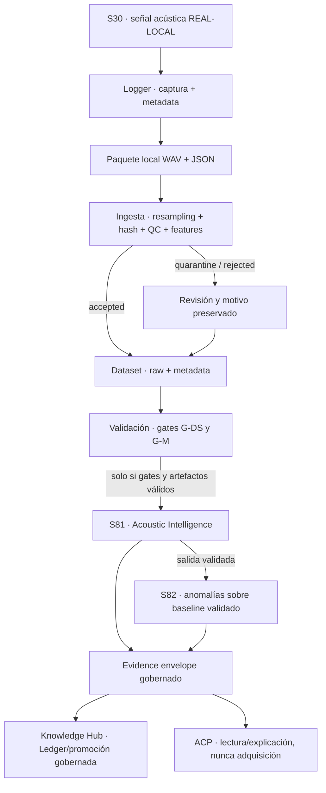

# CMSC · Zona de Orquestación Científica V2

**Misión:** `CMSC_ORCHESTRATION_V2_CANONICAL_DESIGN`  
**Fecha:** 2026-10-04  
**Estado:** DISEÑO CANÓNICO · NO IMPLEMENTADO  
**Ubicación de producto aprobada:** Zona de Orquestación Científica dentro de `/dashboard-cmsc`  
**Regla:** preservar el Logger probado; integrarlo en el flujo CMSC; no crear otra aplicación, página, dashboard, ruta ni laboratorio.

---

## 1. Decisión canónica

`CMSC_DATA_LOGGER_V1` es una **etapa de adquisición del flujo científico CMSC**, coordinada visualmente desde la Zona de Orquestación Científica existente. No es una aplicación ni una superficie independiente.

El prototipo `tools/cmsc-data-logger/capture/index.html` y el puerto `127.0.0.1:8765` fueron un entorno temporal de validación técnica. **8765 no es arquitectura, producto, ruta productiva ni destino de despliegue.** La experiencia final pertenece al contexto y al shell existentes de `/dashboard-cmsc`.

Esta decisión define ubicación y UX. No autoriza código, rutas nuevas, movimiento de componentes, cambios en `CmscDashboard`, S30, Hero, Workbench, backend, Knowledge Hub o modelos.

## 2. Fuente de evidencia y estado de partida

### 2.1 CMSC visible hoy

El orden observado en `CmscDashboard.jsx` es:

1. Cabecera CMSC y `SignalRiver` global.
2. Navegación lateral y vista principal.
3. `MmcHero`.
4. `SpectralAnalysisInstrument` (S30), con su adquisición local y análisis espectral.
5. `SignalExplorerAccordion`, plegado por defecto.
6. Sección `Zona · Orquestación científica`: `RiverSummary` global y `AcpCell`.
7. Sección `Trío · Predecir · Vincular · Benchmark`: `ModelPredictCell`, `LabDoors` y `BenchmarkCell`.
8. Accesos separados a Knowledge Hub, Roadmap y Gobernanza.

La zona actual, por tanto, no contiene todavía Logger, vista de Dataset, gates acústicos ni paneles S81/S82. El río global ya existe fuera de ella y no debe duplicarse como otro río completo.

### 2.2 Activos acústicos y estado honesto al corte

- **S30:** `REAL-LOCAL`; micrófono local y análisis FFT operativo en Telecom/SpectralAnalysisInstrument. El instrumento existente es el productor; la Zona lo referencia, no lo reemplaza.
- **Logger:** prototipo técnico local validado; captura exacta de 3 s, metadata de sesión y clip, cola, WAV PCM16, manifiesto JSON, resampling declarado en ingesta, QC, hash, features y resultados aceptado/cuarentena/rechazado. La página descarga paquete WAV+JSON; no escribe directamente en `/data`.
- **Dataset acústico:** `PREPARADO_VACIO`; metadata con cero filas, cero WAV y cero features. Esquema local v1.1.0, `acoustic.feat.window.v1` aprobado (44 dims), contrato WAV mono PCM16, 44.100 Hz, 3 s, 63 frames.
- **Gates observados:** G-DS-1 `FAIL` por siete AudioSet mids sin verificar; G-DS-2..G-DS-6 `PENDING` por ausencia de muestras/evidencia. No se debe representar esta situación como Dataset validado.
- **S81 Acoustic Intelligence:** `DISENO`; sin clasificador acústico entrenado ni artefactos de validación. Bloqueada por Dataset y gates de modelo.
- **S82 Environmental Anomaly Detector:** `DISENO`; sin baseline, thresholds ni validación; no emite alertas.
- **Knowledge Hub:** visor documental existente; la evidencia/ledger acústico y su promoción siguen en diseño. No hay evidencia acústica que presentar.
- **ACP:** diseño de orquestación de lectura; no ejecuta el Logger ni los laboratorios. Su presencia no debe insinuar que ya coordina esta captura.

Los estados de proceso del Logger (capturando, paquete listo, ingesta pendiente, aceptado, en cuarentena, rechazado) son **estados operativos**, no estados canónicos de honestidad. Deben mostrarse junto con S30/Dataset/S81/S82, no sustituirlos.

## 3. Auditoría visual: conservar, compactar, integrar

| Superficie actual | Decisión de diseño V2 | Motivo |
|---|---|---|
| Hero MMC | **Conservar sin cambios** | Identidad y entrada visual del CMSC; no es parte del flujo acústico. |
| S30 / instrumento espectral | **Conservar sin duplicar** | Sigue siendo el productor y analizador. La zona consume su estado y, cuando exista contrato aprobado, el flujo PCM de solo lectura. |
| SignalRiver global | **Conservar como navegación general** | Resume el ecosistema completo. No convertirlo en otro pipeline acústico ni reemplazarlo. |
| Explorador de señales | **Conservar plegable** | Catálogo transversal; no es control de captura. |
| Zona actual: RiverSummary + ACP | **Reemplazar conceptualmente su resumen repetido por el pipeline acústico**; ACP pasa a contexto secundario | Evita repetir el río global y centra la zona en el trabajo que realmente debe coordinar. No implica mover componentes ahora. |
| Logger 8765: captura/metadata/cola | **Integrar conceptualmente como etapa expandible de la zona** | Preserva la experiencia útil sin página ni aplicación aparte. |
| Estado de Dataset y gates | **Añadir como resumen junto a captura; detalle bajo demanda** | Permite revisar calidad sin convertir la zona en un tablero de métricas permanente. |
| ModelPredictCell | **Conservar separado y rotulado como inferencia agrícola S60/S61** | No es S81 y no consume el Dataset acústico. No reutilizar su resultado como clasificación de audio. |
| BenchmarkCell | **Conservar separado como benchmark agrícola M1/M2** | Dataset V2 de imágenes; la decisión M1/M2 sigue pendiente. No mezclar métricas con S81/S82. |
| LabDoors | **Compactar visualmente a destinos contextuales** | Evitar repetir navegación lateral, Hero y río. Telecom sigue disponible desde su puerta existente. |
| Tarjeta global Knowledge Hub | **Conservar acceso global; en la zona mostrar únicamente el estado acústico de evidencia y su enlace** | No duplicar el Hub ni declarar conocimiento a partir de WAV crudos. |
| Gobernanza y filtro de honestidad | **Conservar como capacidad transversal** | Debe gobernar estados en todas las etapas, no convertirse en un gate visual ficticio. |

“Compactar” y “reemplazar visualmente” son decisiones de diseño: no eliminan funcionalidad ni autorizan mover o borrar componentes.

## 4. Arquitectura visual de la Zona V2

### 4.1 Layout principal

La Zona se plantea como un **flujo acústico con una etapa operativa expandible**, no como siete tarjetas de igual peso:

1. **Cabecera de zona:** nombre, señal en foco (`S30`) y resumen breve del estado actual.
2. **Pipeline acústico compacto:** siete etapas en una línea de escritorio y en una lista/stepper vertical en tamaños estrechos.
3. **Área de trabajo:** Logger expandible como contenido principal; al lado, resumen del Dataset y gates.
4. **Consumidores:** estados compactos de S81, S82 y Knowledge Hub; ACP como contexto de interpretación posterior.
5. **Detalle avanzado plegable:** checks QC, metadata ampliada, remuestreo, features, hashes y motivos de rechazo.

El panel de captura se colapsa al estado resumido cuando no hay sesión activa. Solo se expande durante preparación/captura/revisión. Así el Logger está integrado y accesible sin mantener un panel grande abierto permanentemente.

### 4.2 Mockup textual completo

```text
ZONA DE ORQUESTACIÓN CIENTÍFICA · ACÚSTICA
Productor S30 → adquisición gobernada → Dataset → validación → interpretación → evidencia

[ S30 · REAL-LOCAL ] [ Dataset · PREPARADO_VACIO ] [ S81 · DISEÑO ] [ S82 · DISEÑO ] [ KH · sin evidencia acústica ]

S30 ───── Logger ───── Dataset ───── Validación ───── S81 ───── S82 ───── Knowledge Hub
LIVE      listo         0 clips       G-DS-1 FAIL      bloqueado  bloqueado sin promoción

┌─ CAPTURA · CMSC_DATA_LOGGER_V1 ─────────────────┐ ┌─ DATASET ACÚSTICO ───────────────────┐
│ Sesión [________]  Lugar [________]              │ │ PREPARADO_VACIO                      │
│ Operador [______]  Dispositivo [____]            │ │ 0 WAV · 0 filas · 0 features         │
│ Clase [_________]  Entorno [_____]               │ │ Aceptadas por clase [sin muestras]   │
│ Hora [__:__]  Clima [______________]             │ │ QC / cuarentena [sin ejecutar]       │
│ Notas [________________________________]         │ │ Split/holdout [NO_EJECUTADO]          │
│                                                  │ │                                       │
│ Contrato: 3 s · mono · PCM16 · 44.1 kHz destino │ │ G-DS-1 FAIL · 7 mids UNVERIFIED       │
│ Entrada nativa: [48 kHz] · resampling declarado │ │ G-DS-2..6 PENDING                    │
│                                                  │ │                                       │
│ [Iniciar captura] [Detener]  0 / 132.300         │ │ [Ver gates y motivos]                 │
│ Nivel [medidor]  Toma [1]  Mic [estado]          │ │                                       │
└──────────────────────────────────────────────────┘ └───────────────────────────────────────┘

TOMAS DE LA SESIÓN · 0
# | Hora | Clase | Duración | Entrada | Paquete | Estado de ingesta

S81 · Acoustic Intelligence     DISEÑO · bloqueada: Dataset + modelo + validación
S82 · Anomaly Detector          DISEÑO · bloqueado: baseline + thresholds + validación
Knowledge Hub                   sin evidencia acústica promovida · Ledger en diseño
ACP                             DISEÑO · lectura/explicación posterior, no controla la captura

[Detalles QC y metadata ▸] [Features derivadas ▸] [Hashes y manifiesto ▸]
```

La maqueta refleja el estado observado al corte. Después de capturas, cada valor debe provenir de metadata, archivos o gates medidos; no rellenar conteos estimados como si fueran muestras reales.

### 4.3 Distribución conceptual

```text
CMSC /dashboard-cmsc
┌──────────────────────────────────────────────────────────────────────┐
│ Cabecera CMSC + río científico global existente                     │
├───────────────┬──────────────────────────────────────────────────────┤
│ Navegación    │ Hero MMC existente                                   │
│ lateral       ├──────────────────────────────────────────────────────┤
│ existente     │ S30 / instrumento espectral existente                │
│               ├──────────────────────────────────────────────────────┤
│               │ Explorador de señales (plegable)                     │
│               ├──────────────────────────────────────────────────────┤
│               │ ZONA V2                                               │
│               │ flujo acústico compacto                              │
│               │ Logger expandible             Dataset + gates        │
│               │ cola/revisión                  resumen y motivos      │
│               │ S81 · S82 · KH · ACP (destinos/estados compactos)     │
│               ├──────────────────────────────────────────────────────┤
│               │ Inferencia agrícola · laboratorios · benchmark        │
│               │ KH global · roadmap · gobernanza                     │
└───────────────┴──────────────────────────────────────────────────────┘
```

La Zona es el foco de adquisición acústica, pero no reemplaza el río global, los paneles agrícolas ni las puertas de laboratorios.

## 5. Flujo científico oficial y contratos de estado



### 5.1 Estados honestos mostrados

| Etapa | Estado actual | Transiciones visibles permitidas |
|---|---|---|
| S30 | `REAL-LOCAL` | Micrófono disponible / no disponible como estado operativo; la clase de señal no cambia por abrir el Logger. |
| Logger | herramienta de captura; no señal IA | `idle → capturing → package_ready → ingest_pending → accepted / quarantine / rejected`. No etiquetar la herramienta como modelo o señal entrenada. |
| Dataset | `PREPARADO_VACIO` | `CAPTADO_INICIAL → CURADO → SPLITEADO → PUBLICADO`, solo por filas y gates con evidencia. |
| Validación | G-DS-1 `FAIL`; G-DS-2..6 `PENDING` al corte | mostrar cada gate con evidencia/razón real; no agregar porcentajes sin cálculo verificable. |
| S81 | `DISENO` | `SIM` solo si se aprueba/implementa una baseline de reglas; `REAL-LOCAL` solo después de los gates y artefactos de ML definidos. |
| S82 | `DISENO` | cold-start sin alertas; operar solo con baseline, threshold y validación aprobados. |
| Knowledge Hub acústico | sin evidencia; Ledger/promoción en diseño | estado de documento/evidencia solo cuando se implemente el flujo gobernado; no elevar estado de S30/S81/S82 por almacenar un registro. |
| ACP | `DISENO` | consulta después de evidencia verificada; nunca inicia el micrófono ni produce resultados por sí solo. |

Los estados operativos de la captura no sustituyen el canon de honestidad. `package_ready` no significa `accepted`; `accepted` no significa `CURADO`; `PUBLICADO` no significa que S81 ya esté validado si faltan gates de modelo.

## 6. Refusión conceptual del prototipo Logger

| Elemento validado en el prototipo | Tratamiento visual en CMSC V2 |
|---|---|
| Selección de clase | Visible, ligada al protocolo; OOD no se presenta como una clase normal de captura bajo demanda. |
| Sesión, lugar, operador, dispositivo | Visibles al preparar sesión; obligatorios destacados. |
| Entorno, hora local, clima, notas | Visibles en metadata de sesión; clima/notas compactos, conservados. |
| Micrófono y tasa nativa | Estado de S30 y entrada nativa; no solicitar un segundo permiso de micrófono en paralelo. |
| Captura exacta de 3 s | Control principal; progreso en muestras/tiempo, auto-stop y salida conforme al contrato. |
| Cola de tomas | Visible durante sesión, con clase/duración/estado; limpiar la cola no borra WAV persistidos. |
| WAV PCM16 + manifiesto JSON | Acción de paquete/exportación local hasta que una integración de ingesta devuelva confirmación verificable. |
| Resampling y contrato 44.1 kHz | Resumen compacto; método y tasa de origen visibles en “Avanzado”. Nunca etiquetar el SR de destino como nativo si fue remuestreado. |
| AC-1..AC-10, features y hash | QC con resultado y causa breve; detalle técnico plegable y auditable. Features son derivadas, no ground truth. |
| Bitácora | Plegable, conservar errores operativos y motivos de rechazo/cuarentena. |

**Restricción de integración:** hoy el instrumento S30 y el prototipo web adquieren audio de manera independiente. Para cumplir el flujo oficial sin duplicar permisos ni capturas, una implementación futura necesita un contrato de adquisición compartido de solo lectura que permita al Logger recibir PCM crudo y su sample rate antes del suavizado/FFT del instrumento. No se asume que la ventana FFT de S30 sea por sí sola un WAV reconstruible. Diseñar y aprobar ese contrato es un gate previo; esta misión no modifica S30.

## 7. Experiencia por contexto

### Escritorio
- Pipeline de siete etapas en horizontal, bajo la cabecera de Zona V2.
- Logger y resumen Dataset en dos columnas; Logger ocupa la columna principal.
- Cola y gates inmediatamente debajo; salidas S81/S82/KH en una banda compacta.
- ACP reducido a contexto de consulta posterior. Benchmark agrícola permanece en su sección independiente.

### Portátil
- Pipeline horizontal desplazable o resumido al paso actual con etapas vecinas visibles; no repetir tarjetas gigantes.
- Captura arriba, Dataset/gates debajo; metadata opcional y QC profundo plegables.
- Mantener siempre a la vista clase, sesión, micrófono, duración y estado de ingesta.

### Captura de campo
- Modo de foco dentro de la misma Zona y `/dashboard-cmsc`, no aplicación, laboratorio ni ruta nueva.
- Prioridad: S30 conectado, sesión/lugar, clase, iniciar/detener, progreso, nivel y cola de tomas.
- Campos avanzados plegados, pero conservados y accesibles; feedback de permiso, desconexión y toma incompleta visible.
- Al salir del foco, regresar a la Zona con la sesión y los estados intactos.

## 8. Impacto visual en el CMSC

- La zona gana prominencia funcional después de S30, pero el Logger inicia colapsado cuando no hay sesión. Captura activa expande el área de trabajo; no aumenta permanentemente el scroll.
- El río global conserva amplitud ecológica. El pipeline acústico es un subflujo de trabajo, no reemplazo ni duplicado.
- Evitar tres focos dominantes simultáneos: Hero, instrumento S30 y Logger. El Hero conserva su identidad; S30 conserva el análisis; Logger obtiene prioridad solo durante adquisición.
- `LabDoors`/accesos laterales y tarjetas globales no desaparecen: la zona usa vínculos compactos y contextuales para no repetir su contenido.
- Los paneles M1/M2 y de inferencia agrícola no se absorben en la experiencia acústica. Así no se mezclan los datos de imágenes con las métricas de S81.
- Al corte observado, 5173 sirvió `/dashboard-cmsc` y mostró errores 500 de telemetría; `FRONTEND_EXECUTION_STRATEGY.md` aún define 5173 como legacy congelado y 5174 como frontend de evolución, que estaba apagado. La arquitectura destino es `/dashboard-cmsc`; el puerto/build que recibirá el futuro cambio requiere confirmación y gate visual aparte.

## 9. Riesgos y gates antes de implementar

| Riesgo | Respuesta de diseño / gate requerido |
|---|---|
| Adquisición duplicada entre S30 y Logger | Contrato de source compartido de solo lectura; un solo permiso, sample rate y flujo de PCM trazables. |
| Descarga confundida con ingesta | Estado `ingest_pending`; Dataset solo cambia ante resultado del CLI/puerto de ingesta verificable. El CLI actual no consume el manifiesto de captura ni devuelve estado a la UI. |
| Dataset vacío mostrado como progreso | Conteos calculados desde metadata/WAV; estado actual `PREPARADO_VACIO`, cero muestras. |
| Gates resumidos sin causa | Mostrar PASS/FAIL/PENDING y referencia al criterio/evidencia; no convertir ausencia de medición en PASS. |
| Confusión con Benchmark/IA agrícola | Etiquetar alcance agrícola y mantener sus métricas fuera del flujo acústico. |
| S81 promocionado por existir una fila/feature | Exigir G-DS y G-M, pesos/versionado, `validation_metrics.json` y `model_card.md`. |
| S82 genera falsas alertas | Cero alertas en cold-start; no operar sin baseline y threshold validados. |
| Evidencia cruda publicada como conocimiento | Dataset y KH son destinos distintos; evidencia acústica solo mediante Ledger/Hangar gobernados cuando existan. |
| Privacidad de voz / campo | Consentimiento, minimización de metadata personal y política explícita de retención/exportación antes del piloto. |
| Puerto/artefacto equivocado | Gate de aceptación en el frontend aprobado; no asumir que el build 5173 refleja `src/frontend`. |

## 10. Roadmap de implementación futura (no autorizado por este documento)

Cada etapa necesita misión explícita y aprobación del gate anterior. Este roadmap no habilita código.

### Fase 0 · Congelar contratos de integración
- Aprobar este diseño y el contrato S30 → Logger para PCM crudo, sample rate nativo, duración y ciclo de permiso.
- Definir cómo la ingesta CLI consume WAV/manifest y cómo devuelve resultado; elegir sin inventar si será filesystem/local bridge u otro puerto permitido.
- Gate: no hay segunda adquisición, datos de muestra nunca alteran Dataset real, estados de error visibles.

### Fase 1 · Superficie de Zona V2
- Presentar el flujo acústico dentro de la Zona ya existente en `/dashboard-cmsc`, con datos vacíos honrados y sin duplicar Hero, S30, río global, Benchmark o KH.
- Gate: build/rutas preservadas; `PREPARADO_VACIO`, S81/S82 `DISENO`; ninguna acción aparenta ingesta.

### Fase 2 · Captura y handoff
- Integrar la experiencia probada de captura, metadata, cola, exportación y motivos de QC con el contrato S30 aprobado.
- Gate: captura exacta; WAV/JSON y metadata concordantes; flujo de permiso/error; suite AC-1..AC-10; reproducción y manejo del paquete sin pérdida.

### Fase 3 · Dataset, gates y resultados
- Mostrar confirmación real de ingesta, estado de cada gate, revisión/cuarentena y split solo al existir herramientas/evidencia correspondientes.
- Gate: conteos contra metadata/archivos; G-DS nunca pasa por ausencia; ningún estado se altera solo por texto UI.

### Fase 4 · S81, S82 y Knowledge Hub
- S81 únicamente tras entrenamiento y validación conforme G-M/G-DS; S82 tras baseline/threshold y validación; Ledger/KH tras gobierno F3E.
- Gate: fixtures contra clases/confianzas inventadas; métricas y model card; cold-start sin alertas; trazabilidad de evidencia.

## 11. Decisiones y no-decisiones

### Aprobado por la misión del 2026-10-04
1. Logger como etapa dentro de la **Zona de Orquestación Científica** de `/dashboard-cmsc`.
2. `8765` fue entorno temporal de validación y queda descartado como producto, ruta o arquitectura final.
3. Flujo oficial: **S30 → Logger → Dataset → Validación → S81 → S82 → Knowledge Hub**.
4. Preservar captura, metadata, gobernanza, cola, WAV/JSON, QC, resampling declarado, hashes/features y causas de cuarentena/rechazo.
5. No crear página/ruta/dashboard/laboratorio/aplicación independiente; no implementar en esta misión.

### No aprobado ni resuelto por diseño
- No se aprobó compartir PCM desde S30 ni se modificó el instrumento.
- No se aprobó escritura directa de navegador al Dataset; ingesta sigue pendiente de confirmación desde el proceso local.
- No se aprobó Ledger acústico, clasificación S81, baseline S82, entrenamiento, inferencia, ACP operativo ni promoción al KH.
- No se cambió el rol de `5173`/`5174`; se mantiene la discrepancia documentada hasta su resolución.

**Conclusión:** el Logger pertenece al cauce de orquestación porque convierte una señal S30 en una muestra trazable del Dataset. La zona V2 lo presenta como una etapa expandible con resultados verificables; el instrumento S30 sigue siendo el productor, y los modelos/KH siguen bloqueados hasta que exista evidencia real.

## 12. Visual Freeze — distribución aprobada

**VISUAL FREEZE APPROVED**  
**Fecha/hora:** 2026-10-04 21:51:22 (America/Bogota, UTC-05:00)  
**Estado:** DISEÑO CONGELADO · NO IMPLEMENTAR  
Esta sección resuelve y prevalece sobre cualquier ambigüedad de distribución en §§3–8. No modifica el orden ni el contenido de componentes existentes.

### 12.1 Orden visual exacto en `/dashboard-cmsc`

1. Cabecera CMSC y `SignalRiver` global: se conservan, no se duplican dentro de la zona.
2. Navegación lateral existente.
3. Hero MMC existente, intacto.
4. Instrumento S30 existente, intacto y único productor visible de la captura.
5. Explorador de señales, plegado por defecto.
6. **Zona de Orquestación Científica V2**, con las cuatro franjas definidas abajo.
7. Sección existente de inferencia agrícola, `LabDoors` y `BenchmarkCell`, intacta y fuera del pipeline acústico. M1/M2 no se mezclan con S81.
8. Accesos globales existentes a Knowledge Hub, Roadmap y Gobernanza, intactos.

### 12.2 Distribución congelada de la Zona V2

**Franja A · Cabecera y pipeline (siempre visible).** Título de la zona, estado de captura/Dataset y stepper compacto de siete etapas: `S30 → Logger → Dataset → Validación → S81 → S82 → Knowledge Hub`. Es subflujo de trabajo acústico; no sustituye al río global.

**Franja B · Trabajo principal.** Dos columnas en escritorio: Logger a la izquierda (aprox. 7/12) y Dataset+Validación a la derecha (aprox. 5/12). Logger expandido solo al preparar/iniciar/revisar una sesión; en reposo queda en resumen de estado y acción de captura. Dataset muestra estado, conteos con unidad explícita y gates con su motivo. No muestra porcentajes inventados.

**Franja C · Consumidores acústicos (siempre resumidos).** Tres estados compactos en línea: S81, S82 y Knowledge Hub. S81 enumera bloqueos Dataset/modelo/validación; S82 enumera baseline/thresholds/validación; Knowledge Hub indica si hay evidencia acústica promovida. No se embebe una copia del Hub.

**Franja D · Supervisión y contexto.** ACP permanece dentro de la Zona en el lugar conceptual actual, debajo del flujo, como resumen compacto de lectura y explicación; se expande bajo demanda, sigue `DISEÑO` y no controla captura. `LabDoors` y `BenchmarkCell` permanecen en su sección existente posterior, sin traslado ni duplicación. El benchmark mantiene el rótulo y contexto agrícola M1/M2, ajeno al flujo acústico.

### 12.3 Wireframe del freeze

```text
ZONA DE ORQUESTACIÓN CIENTÍFICA V2 · ACÚSTICA
Estado: Logger en reposo · Dataset PREPARADO_VACIO · 0 muestras

[S30 REAL-LOCAL] → [Logger] → [Dataset] → [Validación] → [S81 DISEÑO] → [S82 DISEÑO] → [KH sin evidencia]

┌─ CAPTURA · Logger (expandible) ──────────────────┐ ┌─ DATASET + VALIDACIÓN ─────────────────┐
│ Sesión / lugar / operador / dispositivo           │ │ PREPARADO_VACIO · 0 WAV · 0 filas       │
│ Clase / entorno / hora / clima / notas            │ │ Conteo por clase: sin muestras           │
│ Micrófono S30 · contrato 3 s · progreso           │ │ G-DS-1 FAIL · 7 mids UNVERIFIED           │
│ [Iniciar] [Detener] · toma actual                 │ │ G-DS-2..G-DS-6 PENDING                   │
│ Cola de tomas · WAV + metadata/paquete            │ │ [Ver detalle de gates ▸]                  │
└───────────────────────────────────────────────────┘ └──────────────────────────────────────────┘

[S81 DISEÑO · Dataset + modelo + validación]
[S82 DISEÑO · baseline + thresholds + validación]
[Knowledge Hub · sin evidencia acústica promovida]

ACP · DISEÑO · lectura/explicación posterior · [ampliar ▸]

Fuera de esta zona y conservados sin cambios:
[Inferencia agrícola] [Laboratorios vinculados] [Benchmark agrícola M1/M2]
```

### 12.4 Escritorio, portátil y campo

| Contexto | Distribución congelada |
|---|---|
| **Escritorio ≥1280 px** | Stepper horizontal de siete etapas; Franja B en 7/12 + 5/12; S81/S82/KH en tres estados compactos; ACP como resumen de una línea expandible. Benchmark/LabDoors permanecen debajo de la Zona en su sección existente. |
| **Portátil 768–1279 px** | Stepper horizontal compacto con nombres cortos y estado junto al nombre; Logger ocupa el ancho principal, Dataset y gates como columna secundaria si caben; consumidores en fila de tres; ACP resumido. Metadata/QC avanzado plegados. |
| **Móvil/campo <768 px** | Stepper vertical compacto; Logger primero y a ancho completo; Dataset y gates inmediatamente después; S81/S82/KH como filas resumidas expandibles; ACP, Benchmark y LabDoors no interrumpen la toma y permanecen en sus regiones contextuales posteriores. Sin barra fija que oculte el estado de grabación. |

El modo campo es un **estado de foco responsive dentro de la misma Zona y ruta**, no una vista, página o producto nuevos. Debe preservar sesión y cola al cambiar el foco.

### 12.5 Visibilidad congelada

| Estado de interfaz | Contenido |
|---|---|
| **Visible siempre** | Cabecera/pipeline, estado S30, Logger en resumen o captura activa, estado Dataset, resultado/motivo de gates, estados S81/S82/KH y ACP resumido. |
| **Expandido durante captura/revisión** | Metadata de sesión, controles, progreso exacto, nivel, cola de tomas, resultado de cada clip y acción de paquete. |
| **Plegado por defecto** | metadata no obligatoria, notas/clima detallados, vistas de features, hashes/manifiesto completo, AC individuales, explicación extensa de cada gate y detalle ACP. |
| **Conservado fuera de la Zona** | `ModelPredictCell` (agrícola), `LabDoors`, `BenchmarkCell` (M1/M2 agrícolas), acceso global al Knowledge Hub, Hero, instrumento S30 y Explorador. Ninguno se elimina, duplica ni se hace pasar por acústico. |

### 12.6 Jerarquía y restricciones del freeze

1. Prioridad visual: **estado/acción actual → captura → Dataset/gates → consumidores → supervisión/contexto**.
2. Solo Logger recibe expansión dominante durante una sesión activa; al terminar vuelve al resumen.
3. No crear tarjetas de igual peso para siete etapas: el stepper resume y solo el paso actual se expande.
4. Badge de honestidad junto a cada señal/resultado; estado operativo de captura separado del estado canónico.
5. Los conteos son desde evidencia real; paquete descargado se rotula `ingest_pending`, nunca `accepted` ni avance de Dataset.
6. No hay segundo río global, segundo analizador S30, S81 acústico dentro de la tarjeta agrícola ni benchmark M1/M2 aplicado al audio.
7. Si la fuente PCM compartida S30→Logger no está disponible, mostrar **Integración de captura pendiente** y bloquear el inicio; no abrir un `getUserMedia` paralelo como sustituto silencioso.

### 12.7 Plan visual de implementación futura (no autorizado)

| Fase | Alcance visual | Gate de salida |
|---|---|---|
| **V0 · Freeze** | Esta distribución y jerarquía aprobadas como fuente de verdad. | Aprobación del diseño; sin código. |
| **V1 · Zona** | Presentar las cuatro franjas dentro de la zona existente; Logger en reposo, estados reales y consumidores bloqueados honestamente. | No nuevas rutas; río global, Hero, S30, ACP, Benchmark, LabDoors y KH preservados. |
| **V2 · Sesión** | Expandir controles/metadata/cola durante captura y plegar QC avanzado; diseñar interacción de revisión. | Contrato S30 PCM de solo lectura aprobado; no doble permiso; paquete concordante WAV/JSON. |
| **V3 · Dataset** | Confirmación de handoff y estados de ingesta/gates derivados de CLI/Dataset. | La UI no altera estados sin respuesta/evidencia; gates PASS/FAIL/PENDING fieles. |
| **V4 · Consumidores** | Enlazar estados S81/S82/KH solo después de cumplir sus gates científicos. | Modelo/gates/artefactos trazables; S82 cold-start silencioso; KH gobernado. |

Cada fase requiere misión explícita. **VISUAL FREEZE APPROVED no autoriza implementación.**

## 14. Hito oficial — `CMSC_ORCHESTRATION_V2` aprobado

**Fecha del hito:** 2026-10-04  
**Registro:** 2026-10-04 22:06:34 (America/Bogota, UTC-05:00)  
**Estado:** **APROBADO** · cierre de diseño y visual freeze; implementación todavía no iniciada.

### 14.1 Decisiones cerradas

- Visual Freeze: **APROBADO** conforme a §12.
- Arquitectura de la Zona de Orquestación Científica V2: **APROBADA** conforme a este documento.
- Logger acústico como etapa CMSC: **APROBADO**; preserva la funcionalidad técnica validada y no constituye una interfaz independiente.
- Ubicación oficial: Zona de Orquestación Científica.
- Ruta oficial: `/dashboard-cmsc`.
- `127.0.0.1:8765`: **VALIDACIÓN TEMPORAL**, descartado como arquitectura, producto y ruta final.
- Flujo oficial: **S30 → Logger → Dataset → Validación → S81 → S82 → Knowledge Hub**.

### 14.2 Estado del ecosistema al aprobar

| Elemento | Estado aprobado/observado | Límite que no debe inferirse |
|---|---|---|
| S30 | `REAL-LOCAL` | La fuente PCM compartida con Logger todavía requiere contrato técnico. |
| Logger | `VALIDADO` técnicamente | Su integración visual al CMSC aún no se implementó. |
| Dataset | `PREPARADO_VACIO` | 0 muestras; no está poblado, curado ni listo para entrenamiento. |
| S81 | `DISEÑO` | Bloqueada por Dataset, modelo y validación. |
| S82 | `DISEÑO` | Bloqueada por baseline, thresholds y validación. |
| Knowledge Hub | Operativo como Hub documental | No hay evidencia acústica promovida; Ledger acústico no operativo. |
| Zona V2 | `CONGELADA` | El freeze es visual/documental, no código implementado. |

### 14.3 Próxima misión

**`CMSC_ORCHESTRATION_V2_PHASE_1_IMPLEMENTATION`** — integrar visualmente el Logger dentro de la Zona existente de `/dashboard-cmsc`, aplicando exactamente el freeze §12 y la secuencia §13.

Alcance esperado: solo la superficie de integración visual existente necesaria para presentar la Zona V2; sin ruta nueva, aplicación separada o sustitución de piezas preservadas. **No tocar Hero, S30, Workbench, Benchmark, ACP ni Knowledge Hub**; cualquier excepción necesitaría una misión explícita independiente. Resolver visualmente el estado “integración PCM pendiente” en vez de simular conexión.

Este registro **no ejecuta ni autoriza la Fase 1**. La implementación comienza únicamente al recibir esa nueva misión; commits y push permanecen sujetos a autorización explícita.

## 13. `CMSC_ORCHESTRATION_V2_IMPLEMENTATION_PLAN` — roadmap técnico

**Fecha/hora del plan:** 2026-10-04 21:58:24 (America/Bogota, UTC-05:00)  
**Estado:** PLAN · NO IMPLEMENTADO · requiere autorización separada por fase.  
El orden es secuencial; una fase no pasa a la siguiente si su gate de salida no tiene evidencia.

### Fase 1 · Integración visual mínima

- Integrar la distribución congelada en la Zona ya existente de `/dashboard-cmsc`, preservando shell, Hero, S30, ACP, Benchmark, LabDoors, Knowledge Hub, navegación global y río global.
- No añadir ruta ni duplicar el instrumento S30, el río, las tarjetas agrícolas o el Knowledge Hub.
- Consumir estados reales; en estado inicial mostrar Logger sin fuente conectada, Dataset `PREPARADO_VACIO`, S81/S82 `DISENO` y gates actuales. Acciones de captura permanecen bloqueadas hasta aprobar el contrato S30.
- **Gate F1:** prueba visual sobre el frontend autorizado; flujo completo dentro de la zona existente; responsive escritorio/portátil/campo; cero regresión de los elementos preservados; ninguna etiqueta de ingesta ficticia.

### Fase 2 · Logger conectado

- Aprobar primero el contrato S30→Logger de captura PCM de solo lectura: forma PCM, tasa nativa, canales, timestamps, ciclo de permiso, cierre/cancelación y propiedad de la única adquisición. No reconstruir WAV a partir de frames FFT.
- Sustituir conceptualmente el micrófono duplicado del prototipo por ese contrato; conservar captura exacta de 3 s, metadata, cola, WAV PCM16, manifiesto, errores y exportación local.
- Conectar el manifiesto WAV/JSON al CLI de forma verificable: mapear cada archivo a su metadata y devolver `accepted`, `quarantine` o `rejected` con causa. `package_ready`/descarga no significa ingesta.
- Probar con fixtures/temporales; nunca apuntar pruebas al Dataset real por defecto.
- **Gate F2:** una toma S30 produce un paquete reproducible; metadata y WAV concuerdan; duración/conteo exactos, resampling declarado, destino único, sin segundo permiso ni pérdida de tomas; handoff CLI confirma el resultado.

### Fase 3 · Dataset operativo

- Habilitar la ruta controlada de ingesta al Dataset local fuera de Git, con metadata como tabla maestra y derivados regenerables.
- Ejecutar QC AC-1..AC-10, escribir hashes/features/manifest de forma trazable y preservar rechazados/cuarentena con sus motivos; mantener clase, sitio, sesión, dispositivo y anotación.
- Implementar materialización de curación y split agrupado/holdout requerido por la gobernanza, con reportes reproducibles. No afirmar que el Dataset está curado o splitteado antes de la evidencia.
- Derivar y presentar `dataset_state` solo desde artefactos y gates cumplidos; proteger datos de voz/consentimiento y respaldar metadata según la gobernanza.
- **Gate F3:** muestras reconciliadas entre metadata, WAV, features y checksums; split/holdout verificables; conteos de clase y procedencia comprobados; Dataset solo avanza al estado que permiten sus gates.

### Fase 4 · Gates

- Ejecutar G-DS-1..G-DS-6 y SG-1..SG-5 desde evidencia; cada gate presenta `PASS`, `FAIL` o `PENDING`, criterio, dato medido y razón bloqueante.
- Corregir la verificación taxonómica de G-DS-1; implementar validación de contenido de manifiestos/checksums y de listas/holdout de G-DS-3/G-DS-4; calibrar el umbral near-duplicate antes de declararlo efectivo.
- Para G-DS-6, no aproximar Cohen κ desde `agreement`: definir y aprobar cómo capturar las etiquetas individuales de cada anotador/clase, versionar el contrato si corresponde y calcular κ con tabla de contingencia real. Hasta entonces, G-DS-6 queda `PENDING`.
- Evaluar también todos los gates G-M requeridos para promoción del modelo; ningún gate pasa por falta de datos.
- **Gate F4:** conjunto completo de resultados reproducible, evidencia archivada y bloqueos resueltos. Si faltan mid verificado, split, doble etiqueta o métrica, la fase queda bloqueada.

### Fase 5 · S81 Acoustic Intelligence

- Entrenar únicamente después de F3/F4 y del volumen mínimo gobernado. Entrada inicial congelada: `acoustic.feat.window.v1`, 44 dimensiones; comparar baselines tabulares conforme al benchmark acústico. M1/M2 agrícolas no son candidatos acústicos.
- Generar configuración, pesos/versionado, normalización, `validation_metrics.json` y `model_card.md`; medir macro-F1, balanced accuracy, per-class, ECE, OOD AUROC, latencia, tamaño y generalización por sitio.
- Integrar inferencia sin bloquear S30, mostrando método, modelo, `sourceMode`, confianza calibrada y estado junto al resultado. No mostrar predicción hasta existir modelo/artefactos aprobados.
- **Gate F5:** G-DS y G-M aprobados, artefactos completos, validación por grupo/sitio y OOD aceptable. Hasta entonces S81 permanece `DISENO` (o `SIM` solo para baseline heurístico aprobado).

### Fase 6 · S82 Environmental Anomaly Detector

- Empezar solo después de un S81/dataset acústico gobernado y una definición operacional del baseline normal por sitio/franja temporal.
- Calibrar threshold con datos separados; medir falsos positivos/negativos, deriva y comportamiento por entorno. Durante `cold-start`, emitir cero alertas.
- Mostrar score, threshold, baseline state y procedencia; separar “evento nuevo” de anomalía confirmada y evitar intervención automática sobre colmenas.
- Conectar salidas S81/S82 a evidencia acústica gobernada y al Knowledge Hub solo cuando existan ledger/política de promoción aprobados; ACP es consumidor lector posterior.
- **Gate F6:** baseline y threshold versionados, desempeño y FPR aceptados, cold-start y fixtures de rechazo validados, trazabilidad completa. Sin gate, S82 permanece `DISENO`.

### Secuencia y criterio de no avance

`F1 → F2 → F3 → F4 → F5 → F6`. F1 puede presentar estados vacíos/bloqueados; F2 depende del contrato PCM S30 y del handoff CLI; F3/F4 habilitan datos aptos; F5 habilita S81; F6 habilita S82 y la evidencia posterior al Knowledge Hub. Una misión explícita distinta debe autorizar cada implementación. Este plan no cambia el Visual Freeze ni constituye permiso para programar.
