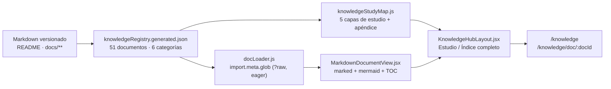

# Knowledge Hub — Arquitectura vigente

| Campo | Valor |
|---|---|
| Estado | **Implementado y operativo** en el frontend de evolución |
| Ruta | `/knowledge` y `/knowledge/doc/:docId` |
| Última revisión | 2026-11-23 |
| Responsable | Bernardo Adolfo Gómez Montoya |
| Fuente de verdad documental | [`docs/`](docs/MASTERDOC.md) |
| Registro canónico del Hub | [`knowledgeRegistry.generated.json`](src/frontend/src/knowledge-hub/registry/knowledgeRegistry.generated.json) |

> **Alcance.** Este documento describe la arquitectura **ya implementada** del portal documental local de SIGC&T Rural. No es un plan pendiente. La propuesta original de 2026-07-16 — redactada cuando el portal aún no existía — se conserva íntegramente en `.local_backups/02_arquitectura_y_gobernanza/KNOWLEDGE_HUB_ARCHITECTURE_ORIGINAL_RESPALDO_2026_11_23.md`.

---

## 1. Propósito

El Knowledge Hub convierte la documentación del repositorio en una capa de producto: fuente local, catálogo explícito, navegación semántica, lectura confiable y trazabilidad. Sirve a tres audiencias: personas que se incorporan al proyecto, mantenedores que necesitan continuidad y sistemas de IA que requieren contexto verificable.

**Principios operativos**

- La documentación se sirve desde el propio build; no depende de GitHub Raw ni de CDNs.
- `docs/` es la fuente única de verdad; el Hub lee, nunca escribe.
- Nada se elimina: lo que deja de ser relevante se reclasifica y se mantiene accesible.
- Cada documento declara su procedencia y su estado con el canon del ecosistema (`REAL`, `REAL-LOCAL`, `REF`, `SIM`, `DISENO`, `ROTO`, `HUERFANO`).
- La presentación es académica y sobria; las etiquetas de estado informan, no publicitan.

---

## 2. Topología implementada

### 2.1 Fuentes y registro

El catálogo se genera en [`knowledgeRegistry.generated.json`](src/frontend/src/knowledge-hub/registry/knowledgeRegistry.generated.json) (`generated_at: 2026-07-19T12:43:05.824Z`, `source_version: local-workspace-mvp-expanded`). Cada entrada declara:

`id` · `title` · `canonical_path` · `route` · `category` · `level` · `document_type` · `format` · `visibility` · `status` · `source_of_truth` · `tags`.

| Categoría | Documentos | Papel |
|---|---:|---|
| `project-core` | 7 | Identidad, arranque, arquitectura y API del proyecto |
| `eiarc-foundation` | 3 | Fundamentos y misión del ecosistema |
| `eiarc-architecture` | 13 | Contextos, contratos y modelos canónicos |
| `research-v2` | 18 | Programa de I+D, datasets y gobernanza científica |
| `knowledge-base` | 6 | KB de auditoría y contexto histórico |
| `historical` | 4 | Evidencia de sesiones superadas, conservada |
| **Total** | **51** | **6 categorías** |

La ruta de cada documento es derivada del `id` (`/knowledge/doc/<id>`) y la ruta canónica del `canonical_path`. No existen páginas React por documento: el router es único.

### 2.2 Carga local

[`docLoader.js`](src/frontend/src/knowledge-hub/services/docLoader.js) resuelve `canonical_path` contra un índice construido con `import.meta.glob(..., { query: '?raw', import: 'default', eager: true })` sobre `README.md`, `SIGCT_RURAL_SYSTEM_BOOT.md`, `docs/MASTERDOC.md`, `docs/PLAN_MAESTRO.md`, la guía técnica de refactorización, `docs/EDGE_SETUP.md`, `docs/API_REFERENCE.md` y los árboles `docs/eiarc/**`, `docs/project_knowledge_base/*`, `docs/historical/*` y `docs/ai/research_v2/*`.

- Sin `fetch` a `raw.githubusercontent.com` ni a ningún CDN.
- `loadDocument(docId)` falla con un mensaje explícito si el `id` no está en el registry o si el patrón `glob` no cubre su ruta canónica.
- `isKnownDocument(docId)` permite validar referencias antes de renderizar.

### 2.3 Renderizado

[`MarkdownDocumentView.jsx`](src/frontend/src/knowledge-hub/components/MarkdownDocumentView.jsx) usa `marked` y `mermaid` como dependencias reales de npm (`marked ^18`, `mermaid ^11`). [`markdownRenderUtils.js`](src/frontend/src/knowledge-hub/services/markdownRenderUtils.js) reutiliza la lógica de anclas, tabla de contenidos y bloques Mermaid ya presente en el visor histórico, sin reescribirla.

El render incluye: tabla de contenidos generada desde encabezados, anclas estables (sin acentos), bloques Mermaid convertidos a contenedores y ejecutados en tema oscuro, y un estado de error visible cuando el documento local no puede cargarse.

---

## 3. Experiencia de estudio

[`knowledgeStudyMap.js`](src/frontend/src/knowledge-hub/catalog/knowledgeStudyMap.js) organiza la lectura sin tocar el registry. Define un punto de partida, cinco capas didácticas y un apéndice plegable.

| Capa | Enfoque |
|---|---|
| 01 · Captura y señales | Qué se mide, quién lo produce y bajo qué contrato entra |
| 02 · Transporte y telemetría | Cómo la señal llega al backend y al dashboard |
| 03 · Datos y gobernanza | Esquemas, datasets, honestidad de estado y preservación |
| 04 · Modelos e inferencia | M1/M2, puertos de IA y contratos de inferencia |
| 05 · Validación y trazabilidad | Gates, evidencia y retorno al conocimiento |

Cada capa declara preguntas, resultados de aprendizaje, entidades, módulos, contratos y prerrequisitos, usando solo `docIds` existentes. El modo **Estudio** muestra la capa activa con filtro por categoría; el modo **Índice completo** expone los 51 documentos agrupados.

Los 9 `docIds` de ruido de herramienta (6 fichas KB y 3 duplicados históricos) no se eliminan: se excluyen de la ruta principal y se muestran en el **Apéndice de auditorías**. Esta decisión materializa la regla NADA DESAPARECE sin penalizar la lectura principal.

---

## 4. Gobernanza de la información

- **Visibilidad y criticidad:** los campos `visibility`, `status` y `source_of_truth` del registry son la única fuente de estas etiquetas; la interfaz no las inventa.
- **Preservación:** los documentos históricos y las auditorías siguen accesibles. La depuración reorganiza, nunca borra.
- **Coherencia:** cuando un documento canónico cambia de estado, se actualiza su definición en el documento canónico correspondiente y luego se regenera el registry; no se parchea la vista.
- **Límites del Hub:** el portal no escribe en `docs/`, no ejecuta laboratorios, no decide gobernanza y no promueve modelos. Es lector y organizador de evidencia.

---

## 5. Estructura de archivos

| Archivo | Responsabilidad |
|---|---|
| `src/frontend/src/App.jsx` | Declara las rutas `/knowledge` y `/knowledge/doc/:docId` |
| `src/frontend/src/knowledge-hub/pages/KnowledgeHubLayout.jsx` | Shell, modos Estudio/Índice, navegación y apéndice |
| `src/frontend/src/knowledge-hub/catalog/knowledgeStudyMap.js` | Capas didácticas, categorías, nodos y reglas de ruido |
| `src/frontend/src/knowledge-hub/registry/knowledgeRegistry.generated.json` | Catálogo generado: 51 documentos / 6 categorías |
| `src/frontend/src/knowledge-hub/services/docLoader.js` | Resolución local de `canonical_path` |
| `src/frontend/src/knowledge-hub/services/markdownRenderUtils.js` | Anclas, TOC y bloques Mermaid |
| `src/frontend/src/knowledge-hub/components/MarkdownDocumentView.jsx` | Render Markdown/Mermaid y manejo de errores |

---

## 6. Fuera de alcance (estado `DISENO`)

Las siguientes capacidades son objetivos declarados, **no funcionalidad instalada**:

- búsqueda semántica / vectorización y puente con un asistente de IA;
- grafo de trazabilidad interactivo entre documentos;
- línea de tiempo documental y panel de continuidad automatizado;
- control de acceso por audiencia más allá de las etiquetas del registry.

Deben entrar por una misión explícita, con gate propio y sin presentarse hoy como parte del Hub implementado.

---

## 7. Criterios de verificación

1. El registry carga 51 documentos en 6 categorías y todas las rutas `/knowledge/doc/<id>` resuelven.
2. Todos los `docIds` usados por el mapa de estudio existen en el registry.
3. No aparece `raw.githubusercontent.com` ni imports desde CDN en `src/frontend/src/knowledge-hub/`.
4. `node --check` pasa en los módulos `.js` del Hub y el build de Vite compila.
5. Los 9 documentos de auditoría siguen accesibles desde el apéndice.
6. Ningún documento se elimina ni se duplica al reorganizar la navegación.

---

## 8. Continuidad

La arquitectura descrita sustituye el enfoque de "páginas Docs" por un único portal local sin destruir su historia: el contenido anterior, incluidas las propuestas no ejecutadas, permanece en el respaldo indicado al inicio y en la documentación histórica versionada. Toda evolución futura debe preservar esas tres reglas: fuente local, catálogo único y nada desaparece.

---

**SIGC&T Rural · Knowledge Hub · Arquitectura vigente · 2026-11-23**
