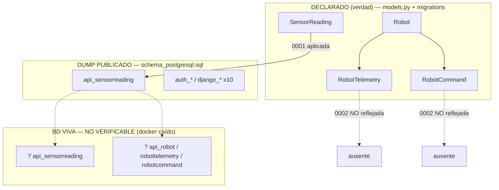

# G1_SCHEMA_CONSISTENCY_REPORT

> **Misión:** `SIGCTIARURAL_G1_SCHEMA_CONSISTENCY_AUDIT`
> **Tipo:** Auditoría forense de solo lectura · derivación de la verdad del esquema.
> **Rama:** `feature/cmsc-f3c-v1-implementation` (sin push).
> **Regla suprema de esta auditoría:** solo se AFIRMA lo que está en el código/artefactos. Lo demás se marca `SIN EVIDENCIA`. No se modificó código, no se generaron migraciones, no se hizo commit, no se hizo push.
>
> **Fuentes fijadas:** `schema_postgresql.sql`, `src/backend/api/models.py`, `src/backend/api/migrations/`, `docker-compose.yml`, `src/backend/sigct_backend/settings.py`, `src/backend/api/urls.py`, `src/backend/api/serializers.py`, `src/backend/api/views.py`, `repositories`, puertos y adapters.

---

## 0. Método

1. Extracción literal de las `CREATE TABLE` de `schema_postgresql.sql` (dump `pg_dump 15.15`, BD `15.15`, **schema-only**: no contiene sentencias `COPY`/datos).
2. Extracción literal de las clases `models.Model` de `models.py`.
3. Inventario de migraciones reales del proyecto + `django_migrations` referenciada.
4. Cruce modelo ↔ migración ↔ dump.
5. Verificación de repositorios, puertos y adaptadores (persistencia y salida).
6. Verificación de configuración de BD (`settings.py`, `docker-compose.yml`, `.env`/`.env.example`).

**Estado del entorno:** daemon Docker NO disponible (`npipe:////./pipe/dockerDesktopLinuxEngine`), por lo que **no se pudo consultar la base de datos real**. La conclusión sobre la BD viva es por inferencia declarada, no por acceso directo.

---

## 1. Tabla comparativa

### 1.1 Tablas en `schema_postgresql.sql` (respuesta A)

| Tabla | Origen | Evidencia |
|---|---|---|
| `public.api_sensorreading` | App `api` (dominio) | `schema_postgresql.sql:29-35` |
| `public.auth_group` | Django built-in | `:84` (CREATE) |
| `public.auth_user` | Django built-in | `:122` (CREATE) |
| `public.auth_user_groups` | Django built-in | `:160` |
| `public.auth_user_user_permissions` | Django built-in | `:201` |
| `public.auth_permission` | Django built-in | `:111` (CREATE) |
| `public.auth_group_permissions` | Django built-in | `:84` |
| `public.django_admin_log` | Django built-in | `:221` |
| `public.django_content_type` | Django built-in | `:261` |
| `public.django_migrations` | Django built-in | `:288` |
| `public.django_session` | Django built-in | `:316` |

**Total: 11 tablas.** Solo **1** es de dominio (`api_sensorreading`); **10** son built-in de Django.

> Verificación: `SELECT` sobre `CREATE TABLE public.` arroja exactamente esos 11 nombres (más abajo, el dump define además secuencias, constraints y FK, todos asociados a esas 11 tablas).

### 1.2 Modelos en `models.py` (respuesta B)

| Modelo | Tabla implícita | Campos | Evidencia |
|---|---|---|---|
| `SensorReading` | `api_sensorreading` | `sensor_id` Char(50) def `BBB-03`, `temperature` Float, `humidity` Float, `timestamp` DateTime def now | `models.py:4-14` |
| `Robot` | `api_robot` | PK `robot_id` Char(50) unique, `name` Char(100), `type` enum(ground/aerial/arm), `status` enum, `created_at` | `models.py:20-39` |
| `RobotTelemetry` | `api_robottelemetry` | FK→`Robot`, `battery_level` Float, `status_mode` Char, `position_{x,y,z}`, `velocity_linear`, `timestamp` | `models.py:41-53` |
| `RobotCommand` | `api_robotcommand` | FK→`Robot`, `command_type` Char(50), `payload` JSON, `priority` enum, `status` enum, `created_at`, `executed_at`, `result_log` | `models.py:55-83` |

**Total: 4 modelos de dominio.**

### 1.3 Modelos con migraciones (respuesta C)

| Migración | Modelos creados | Evidencia |
|---|---|---|
| `0001_initial.py` | `SensorReading` | `0001_initial.py:15-27` |
| `0002_robot_robotcommand_robottelemetry.py` | `Robot`, `RobotCommand`, `RobotTelemetry` | `0002_*.py:15-149` |

**Los 4 modelos tienen migración.** La app `users` (registrada en `INSTALLED_APPS`) **no tiene migraciones** y su carpeta solo contiene `__init__.py`.

### 1.4 Tablas en migraciones que NO aparecen en el dump (respuesta D)

| Tabla esperada por migración | ¿En el dump? | Evidencia |
|---|---|---|
| `api_robot` | ❌ NO | `0002:15-51` vs ausencia en `schema_postgresql.sql` |
| `api_robottelemetry` | ❌ NO | `0002:114-149` vs ausencia |
| `api_robotcommand` | ❌ NO | `0002:52-113` vs ausencia |

> **Nota:** `api_sensorreading` (migración `0001`) **sí** aparece, y sus columnas coinciden exactamente (`id bigint` IDENTITY, `sensor_id` varchar(50) NOT NULL, `temperature`/`humidity` `double precision`, `timestamp timestamptz`) con `0001_initial.py:18-22`.

### 1.5 Tablas del dump sin modelo (respuesta E)

| Tabla del dump | ¿Modelo en el proyecto? |
|---|---|
| `auth_group`, `auth_user`, `auth_user_groups`, `auth_user_user_permissions`, `auth_permission`, `auth_group_permissions`, `django_admin_log`, `django_content_type`, `django_migrations`, `django_session` | **NO** — son tablas built-in de `django.contrib.*`, no declaradas por el proyecto. La app `users` (`INSTALLED_APPS`) está **vacía** (`users/` solo tiene `__init__.py`), así que no aporta modelo. |

**Ninguna tabla del dump carece de dueño:** la 1 de dominio tiene modelo; las 10 restantes son framework.

---

## 2. Divergencias

### D-1 (principal) — Modelos `Robot*` en código y migración, ausentes del dump
- Definidos en `models.py:20-83`, materializados por `0002_robot_robotcommand_robottelemetry.py`.
- **No existen** en `schema_postgresql.sql` (dump tomado antes de aplicar `0002`, o de una BD donde no se aplicó).
- Consistente internamente entre `models.py` y `0002` (mismos campos/choices/relaciones).

### D-2 — `SensorReading` de dominio DUPLICADO
- Dos entidades homólogas: `src/backend/core/domain/entities/sensor_reading.py` y `src/backend/contexts/telemetry/domain/entities/sensor_reading.py`.
- Dos VOs duplicados: `core/domain/value_objects/{temperature,humidity,sensor_id}.py` vs `contexts/telemetry/domain/value_objects/...`.
- Ambos apuntan al **mismo** modelo Django `api.models.SensorReading`.

### D-3 — Repositorios/adaptadores de persistencia DUPLICADOS
- `infrastructure/persistence/django/repositories/django_sensor_reading_repository.py` (puerto `core.ports...`) y `contexts/telemetry/infrastructure/persistence/django/django_sensor_reading_repository.py` (puerto `contexts.telemetry...SensorReadingRepositoryPort`).
- Mismo par duplicado para `SensorReadingMapper` y para los repos in-memory.

### D-4 — Puertos DUPLICADOS
- `AIServicePort`: `core/ports/services/ai_service_port.py` vs `api/logic/ports/ai_service.py`.
- `NotificationPort`: `core/ports/services/notification_port.py`, `api/logic/ports/notifications.py`, `contexts/labs/ports/notifications.py`.
- `SensorReadingRepositoryPort`: `core/ports/repositories/` vs `contexts/telemetry/ports/`.

### D-5 — Artefacto de esquema desactualizado respecto a migraciones
- `schema_postgresql.sql` dokumenta 1 tabla de dominio; migraciones+modelos declaran 4. El dump **no es reproducible** desde el estado de migraciones actual.

### D-6 — Servicio `db-mysql` en compose sin modelo ni driver
- `docker-compose.yml:27-42` define MySQL (`mysql:8.0`) como "residuo". `requirements.txt` solo tiene `psycopg2-binary` (PostgreSQL); no hay driver MySQL ni referencias en código.
- La BD real de Django es PostgreSQL: `settings.py:108-131`. `docker-compose.yml` **no** inyecta `DATABASE_URL` (0 coincidencias); el backend usa la rama manual `CASO B` con `DB_HOST=db`, `DB_PORT=5432` (`docker-compose.yml:54-63`). El `.env` tampoco define `DATABASE_URL`.

### D-7 — Cabeceras de versión Django inconsistentes entre migraciones y `requirements.txt`
- `0001` = "Generated by Django 6.0"; `0002` = "Generated by Django 5.2.10"; `requirements.txt:7` = `Django>=4.2.16,<5.0`.
- No rompe migraciones (son declarativas), pero es una inconsistencia de procedencia.

### D-8 — `settings.py` declara `'users'` en `INSTALLED_APPS` sin modelos/migraciones
- `settings.py:65`. `users/` = solo `__init__.py`. No aporta tablas propias.

---

## 3. Relaciones reales (respuesta F)

### 3.1 Relaciones en el esquema publicado (`schema_postgresql.sql`)
| Relación | Cardinalidad | Evidencia |
|---|---|---|
| `Robot` → `RobotTelemetry` | — (ausente del dump) | — |
| `Robot` → `RobotCommand` | — (ausente del dump) | — |
| `SensorReading` | Sin FK (entidad aislada) | `:29-35` (no define FK) |
| Inter-app: `Robot 1→N RobotTelemetry / RobotCommand` | En código/migración, **no materializadas** | `models.py:42,70`; `0002:104-108,136-143` |

### 3.2 Relaciones declaradas en código (no visibles en el dump)
| Relación | Cardinalidad | Evidencia |
|---|---|---|
| `Robot` → `RobotTelemetry` | 1→N (`related_name=telemetries`, CASCADE) | `models.py:42` |
| `Robot` → `RobotCommand` | 1→N (`related_name=commands`, CASCADE) | `models.py:70` |
| `SensorReading` | aislada (sin FK) | `models.py:4-14` |

### 3.3 Relaciones de persistencia reales (uso)
- `api/models.py` es la **única capa de persistencia** y es consumida por **ambas** arquitecturas hexagonales (nueva y legacy).
- `contexts/telemetry` → `api.models.SensorReading` (repo nuevo).
- `api/logic/adapters/persistence.py` → `apps.get_model('api', ...)` (repo legacy).

---

## 4. Relaciones/documentos "documentados pero no implementados" (respuesta G)

| Afirmación documental | Documento | Estado real |
|---|---|---|
| Context map con `SensorReading` publicando `sensor_reading` hacia Labs (caso piloto) | `wiring.py` (docstring) | **Implementado**, pero `wire_all` no se invoca en arranque Django por AppConfig (`wiring.py:63`); sólo se cablea vía `get_telemetry_event_bus()`. |
| `Robot`/`RobotTelemetry`/`RobotCommand` como subdominio Robótica (Fase 6) | `docs/HEXAGONAL_REFACTOR_PLAN.md:45,50`; `docs/MASTERDOC.md` | En código (modelos+migración) pero **sin puerto/adaptador/repositorio propio** y **ausentes del dump**. Relación "documentada" (codificada) no "materializada en BD". |
| Bounded Context `BiologicalTelemetry` con `BiologicalReadingRepositoryPort`, `BiologicalNodeRepositoryPort`, `BioAlertPort` y `signal_type=biological_reading` | `docs/MASTERDOC.md:324` | **DISEÑO**: no existe código ni tablas. |
| RobotTelemetry como fuente consumible | `REAL_ARCHITECTURE_REPORT.md` §8 | Cliente marcado **ROTO** en inventarios previos (`SIGCTIARURAL_FRONTEND_OFFICIALIZATION_AUDIT.md:69`). |
| Endpoints V3 "ARQUITECTURA HEXAGONAL COMPLETA" | `api/urls.py:27-38` | **Condicionales**: envueltos en `try/except ImportError` → pueden desaparecer silenciosamente. |

> No se documento ninguna relacion adicional como "diseñada pero no implementada".

---

## 5. Entidades huérfanas (respuesta H)

| Entidad | Por qué está huérfana | Evidencia |
|---|---|---|
| `Robot` | Sin consumidor que refleje su existencia en la BD publicada; sin puerto/adaptador; sin FK entrante visible | `models.py:20`; ausencia en dump |
| `RobotTelemetry` | Ídem; su "cliente histórico" está marcado ROTO | `models.py:41`; `SIGCTIARURAL_FRONTEND_OFFICIALIZATION_AUDIT.md:69` |
| `RobotCommand` | Ídem + `IsAuthenticated` sin UI de comando verificada | `models.py:55`; `views.py:31` |
| `SensorReading` (dominio, ×2) | Dos entidades y dos repos para el mismo modelo (riesgo de divergencia) | `core/` y `contexts/telemetry/` |
| App `users` | Declarada en `INSTALLED_APPS` sin código | `settings.py:65`; `users/__init__.py` |

**Sin huérfanas a nivel de tabla:** las 11 tablas del dump tienen dueño (1 de modelo + 10 de framework).

---

## 6. Legacy vs. Hexagonal nueva (respuesta I)

| Elemento | Arquitectura | Evidencia |
|---|---|---|
| `api/models.py` (los 4 modelos) | **Compartida** (persistencia común) | Usada por ambas hex |
| `contexts/telemetry/**` | **Hexagonal NUEVA** | entities, VOs, ports, infra, config |
| `contexts/labs/**` | **Hexagonal NUEVA** | estrategias, handler, ports |
| `shared_kernel/event_bus/**` | **Hexagonal NUEVA** | `LabSignal`, `EventBusPort`, `InMemoryEventBus` |
| `core/**` + `infrastructure/**` | **Paralela intermedia** (segunda hex) | `core/domain`, `core/ports`, `infrastructure/external`, `infrastructure/persistence` |
| `api/logic/**` | **Legacy** (primer intento hexagonal) | `domain/{agricultura,electronica,robotica,telecom}.py`, `ports/`, `adapters/` |
| `api/views.py` V1 (`TelemetryHistoryView`) y ViewSets `Robot*` | **Legacy puro** | usa ORM directo, `AllowAny`, mock |
| `api/views.py` V2 (`TelemetryHistoryV2View`, `AICropAdviceView`) | **Legacy** | usa `api/logic` |
| `api/views.py` V3 (`TelemetryHistoryV3View`, `AICropAdviceV3View`, `TelemetryIngestV3View`) + `AIInferenceV3View` | **Hexagonal NUEVA** | usa `contexts/telemetry` + `core.ports` |
| `api/urls.py` V2 | Legacy | `urls.py:23-24` |
| `api/urls.py` V3 | Nueva | `urls.py:30-46` |

---

## 7. Riesgos

| # | Riesgo | Severidad | Fundamento |
|---|---|---|---|
| R-1 | **La BD viva puede NO tener las tablas `Robot*`** (si se levantó desde el dump/volumen). Cualquier query a `/api/robots/`, `/api/robot-telemetry/`, `/api/robot-commands/` fallaría con `ProgrammingError: relation does not exist`. | 🔴 Alta | `0002` existe pero el dump no las materializa |
| R-2 | **Un desarrollador puede tomar el dump como verdad** y concluir que solo existe 1 entidad de dominio, omitiendo toda la Robótica. | 🟠 Media | `schema_postgresql.sql` es el único `.sql` del repo |
| R-3 | **Desorientación de fuente de verdad**: hay dos hexarquitecturas + un dump desfasado. | 🟠 Media | `core/`, `api/logic/`, `contexts/` |
| R-4 | **Doble mantenimiento `SensorReading`** (dos entidades/repos/mappers) → deriva silenciosa. | 🟠 Media | D-2/D-3 |
| R-5 | **Rutas V3 desaparecen silenciosamente** si falla un import. | 🟠 Media | `urls.py:30-46` |
| R-6 | **`db-mysql` invariante** puede inducir a operar una BD equivocada. | 🟡 Baja | D-6 |
| R-7 | **Inconsistencia de versiones Django** entre migraciones y requirements. | 🟡 Baja | D-7 |
| R-8 | **No se pudo verificar la BD real** por daemon Docker caído → riesgo de decisión sin datos. | 🟠 Media | entorno |

---

## 8. Fuente de verdad recomendada

**Orden de prelación:**

1. **`src/backend/api/models.py` + `src/backend/api/migrations/`** → **fuente de verdad del esquema objetivo**. Gobernado por Django; el estado del esquema es el que resulta de aplicar todas las migraciones en orden.
2. **`docs/MASTERDOC.md` §2.9** (decisión explícita del proyecto): *"el esquema de base de datos se gobierna por `src/backend/api/migrations/` y `models.py`; el archivo `schema_postgresql.sql` en la raíz del repositorio se conserva solo como referencia histórica."* (`MASTERDOC.md:213-217`; fuente `SIGCT_RURAL_SYSTEM_BOOT.md` §18 regla 4).
3. **`schema_postgresql.sql`** → **NO es fuente de verdad**; es un artefacto histórico de una instancia concreta (versión 15.15) que quedó **anterior a `0002`**. Se conserva como evidencia, no como contrato.
4. **`docker-compose.yml` + `settings.py`** → fuente de verdad para **cómo** se conecta el esquema (Postgres 15, `DB_HOST=db`, puerto 5432 interno; `db-mysql` es residuo sin uso).
5. **`views.py`/`serializers.py`/`urls.py`** → fuente de verdad de **exposición** (qué se enumera/crea), no de esquema.
6. **Repositorios/puertos/adapters** → fuente de verdad del **acceso**; confirman que solo `SensorReading` tiene acceso vía puerto; `Robot*` se accede por ORM directo (legacy).

**Veredicto:** la verdad es **`models.py` + `migrations/` (4 modelos)**, y la base publicada está **incompleta** (le falta `0002`). El dump **no contradice** a los modelos: está **desactualizado**.

---

## 9. Plan de corrección (propuesta — NO ejecutado)

> Regla de la misión: **no** crear migraciones, **no** modificar código, **no** commit, **no** push. Los pasos siguientes son propuesta para una misión posterior autorizada.

1. **Verificar estado de migraciones en la BD реаль** (cuando Docker esté arriba):
   `python manage.py showmigrations api` → confirmar si `0002` está aplicada en el entorno vivo.
   (Requiere sacar el daemon Docker de su estado caído; hoy no verificable.)
2. **Aplicar migraciones pendientes** en el entorno correcto:
   `python manage.py migrate` (idempotente) → materializa `api_robot`, `api_robottelemetry`, `api_robotcommand`.
3. **Regenerar el artefacto de referencia** (si se decide mantenerlo):
   re-dump Postgres 15 → `schema_postgresql.sql`, anotando versión de BD y fecha. Alternativa: eliminar el dump del repo y dejar como única referencia las migraciones (alineado con `MASTERDOC §2.9`). **Decisión pendiente del propietario.**
4. **Cerrar la brecha de documentación**: anotar en `MASTERDOC §2.9` que el dump actual precede a `0002` (marcarlo explícitamente como histórico-desactualizado) o reemplazarlo.
5. **Resolver huérfanas de código (misiones aparte, no en esta auditoría):**
   - `Robot*`: decidir si se convierten en bounded context con puertos/adaptadores o se retiran.
   - `SensorReading` duplicado (D-2/D-3/D-4): unificar hacia `contexts/telemetry` o hacia `core`, no ambos.
6. **Limpiar residuos de infra**: retirar `db-mysql` del compose y `'users'` de `INSTALLED_APPS` (o dotar a `users` de contenido real) — **misiones explícitas**, no esta auditoría.

---

## 10. Diagrama del estado real

---

## 11. Síntesis

- **Verdad del esquema:** `models.py` + `migrations/` → 4 modelos de dominio (1 de ellos con tabla publicada).
- **El dump (`schema_postgresql.sql`) es histórico y está desfasado**: refleja solo `0001`. No es fuente de verdad (decisión ya tomada en `MASTERDOC §2.9`).
- **No hay corrupción ni invención**: la divergencia es de **sincronización** (falta aplicar/reflejar `0002`), no de diseño contradictorio.
- **Huérfanas reales:** `Robot`/`RobotTelemetry`/`RobotCommand` (código sin puerto ni dump), app `users` vacía, y `SensorReading` de dominio duplicado en `core/` y `contexts/telemetry/`.
- **Corrección recomendada:** migrar la BD, refrescar o retirar el dump, y resolver duplicidades en misiones separadas. Nada de esto se ejecutó.

Sin cambios de código, sin migraciones generadas, sin commits, sin push.
