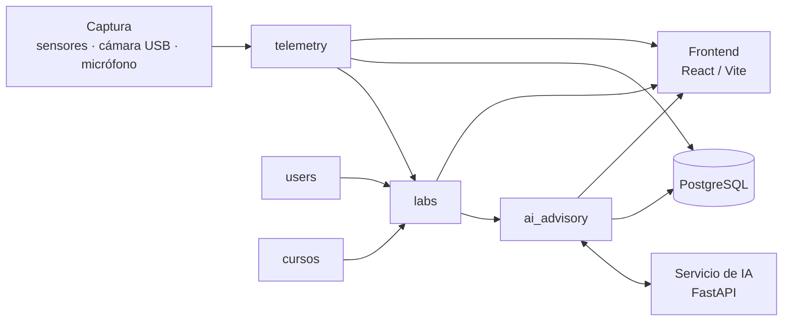
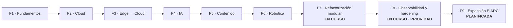

# Plan Maestro — SIGC&T Rural / EIARC

| Campo | Valor |
|---|---|
| Versión | **v8.6 (consolidada)** |
| Estado | Fase 7 en curso · Fase 8 en curso (prioridad actual) · Fase 9 planificada |
| Responsable | Bernardo Adolfo Gómez Montoya |
| Metodología | Iterativa, incremental y verificable |
| Última revisión | 2026-11-23 |
| Identidad canónica | [`docs/ECOSYSTEM_IDENTITY.md`](ECOSYSTEM_IDENTITY.md) |

> **Alcance de este documento.** Es la hoja de ruta técnica vigente: visión, arquitectura, fases y criterios de aceptación. La definición autoritativa de la identidad del ecosistema y de EIARC no vive aquí, sino en [`ECOSYSTEM_IDENTITY.md`](ECOSYSTEM_IDENTITY.md). El detalle operativo se consulta en [`MASTERDOC.md`](MASTERDOC.md) y en los reportes enlazados al final. El contenido íntegro de la versión anterior se conserva, sin borrado, en `.local_backups/02_arquitectura_y_gobernanza/PLAN_MAESTRO_ORIGINAL_RESPALDO_2026_11_23.md`.

---

## 1. Visión

**SIGC&T Rural** es un ecosistema de conocimiento e investigación aplicada, construido sobre bounded contexts (DDD), que se materializa en una plataforma web Cloud/Edge para integrar telemetría, laboratorios virtuales, IA, formación y documentación técnica del sector agropecuario. Su propósito no es clasificar datos: es permitir que una señal real se mida, se modele, se valide y se convierta en evidencia que vuelve al conocimiento.

**EIARC** (Ecosistema de Inteligencia Artificial y Robótica para el Campo) es el caso de uso productivo del ecosistema: la demostración de que lo construido en SIGC&T Rural resuelve un problema agropecuario real. No es una plataforma paralela ni un paraguas; su definición canónica, sus principios y sus límites están en [`ECOSYSTEM_IDENTITY.md`](ECOSYSTEM_IDENTITY.md). La expansión hacia apicultura, piscicultura, ganadería/avicultura e invernaderos se trata como **Fase 9**, se planifica por MVPs individuales y no se inicia mientras no cierren las Fases 7 y 8.

**Principios de continuidad**

- La documentación no se elimina: lo que deja de ser vigente se archiva y se preserva como histórico (NADA DESAPARECE).
- La refactorización es quirúrgica, incremental y verificable; no se rompe funcionalidad operativa para avanzar.
- Toda afirmación técnica lleva evidencia: ejecución, prueba, métrica o documento con fecha y autor.
- Arquitectura, implementación, infraestructura y documentación se mantienen coherentes entre sí.
- La tecnología se adopta por una necesidad verificable del dominio, no por tendencia.

---

## 2. Arquitectura vigente

### 2.1 Topología actual

El núcleo es un **Modular Monolith** con límites hexagonales por contexto. El servicio de IA en **FastAPI** corre como proceso desacoplado por sus dependencias y ciclo de vida propio; el frontend **React/Vite** se sirve de forma independiente y **PostgreSQL** es la persistencia compartida. El objetivo es mantener fronteras claras sin convertir prematuramente el sistema en una arquitectura distribuida.

### 2.2 Contextos delimitados

| Contexto | Responsabilidad | Frontera / contrato |
|---|---|---|
| `telemetry` | Ingesta, normalización y persistencia de lecturas de sensores | `SensorReading` y puertos de repositorio; entrada de señales reales |
| `labs` | Laboratorios y estrategias de dominio | `LaboratorioStrategyFactory` (Strategy/Factory) por línea de trabajo |
| `ai_advisory` | Puente hacia inferencia, validación y gobernanza de modelos | `AIServicePort`, contratos de inferencia y métricas verificables |
| `cursos` | Contenido académico y formación | Catálogo curado y recursos académicos abiertos referenciados |
| `users` | Identidad, roles y sesión | Contrato de autenticación del núcleo |

### 2.3 Evolución controlada hacia EIARC

- El contexto `labs` ya usa Strategy/Factory: una nueva línea de producción se agrega como **una estrategia de dominio nueva**, sin reescribir las existentes.
- `telemetry` es el punto natural de entrada de nuevas señales (ambientales, biométricas, acústicas), sin modificar el contrato de `SensorReading`.
- `ai_advisory` puede incorporar nuevos modelos detrás del mismo `AIServicePort`, manteniendo separadas las capacidades existentes de las nuevas.
- `cursos` es el contexto donde se formalizaría la expansión educativa, sin confundir el ecosistema con un LMS.
- Cada expansión se ejecuta como **MVP individual** con criterios de salida explícitos y después de cerrar Fases 7 y 8.

---

## 3. Mapa real de fases

### 3.1 Fases 1–6 — base arquitectónica y funcional consolidada

| Fase | Resultado consolidado | Estado |
|---|---|---|
| 1 · Fundamentos y arquitectura | Requisitos, plano arquitectónico y stack definidos | Completada |
| 2 · Prototipo Cloud | Comunicación backend/frontend y primer despliegue | Completada |
| 3 · Flujo Edge → Cloud | Pipeline sensor → gateway → API → dashboard | Completada |
| 4 · Integración de IA | Entrenamiento, inferencia y asistente por voz | Completada, con evolución posterior |
| 5 · Contenido académico y pulido | Biblioteca, laboratorios virtuales, UI/UX y artefactos SENA | Completada |
| 6 · Robótica e integración | Contratos de comandos, telemetría de actuadores y control por voz | Completada funcionalmente; cliente de telemetría pendiente de saneo |

Estas fases son la base ya construida. No se reelaboran sus bitácoras aquí: su registro detallado permanece en la documentación histórica y de continuidad.

### 3.2 Fase 7 — Refactorización modular por contextos (en curso)

**Objetivo.** Consolidar el Modular Monolith con límites hexagonales por bounded context, separando reglas de negocio de frameworks y vistas sin interrumpir la operación.

**Líneas de trabajo**

- **Arquitectura:** estructura dominio → puertos → aplicación → infraestructura dentro de cada contexto.
- **Contratos:** puertos explícitos y documentados (`RepositoryPort`, `AIServicePort`, puertos de laboratorio), con productor y consumidor identificados.
- **Dominio:** migración progresiva de lógica hacia estrategias y reglas propias, usando Strategy/Factory donde ya aplica.
- **Entornos:** alineación de Docker, variables y puertos sin afectar otros proyectos locales.
- **Continuidad:** documentación como fuente única, con registro de fecha, autor y evidencia.

**Criterios de salida.** Cada contexto con límites explícitos; contratos consumibles y versionados; cambios verificables con evidencia; funcionalidad existente intacta.

### 3.3 Fase 8 — Continuidad operativa, observabilidad y hardening (prioridad actual)

**Objetivo.** Dejar el sistema reproducible, verificable y seguro para avanzar, con honestidad explícita sobre el estado de cada pipeline.

**Líneas de trabajo**

- Arranque reproducible: base de datos → migraciones → backend → servicio de IA → frontend.
- Checklist por entorno (Docker, entornos virtuales, puertos, variables) y aislamiento frente a otros proyectos.
- Observabilidad mínima: logs estructurados, health checks y trazabilidad de errores.
- Validación de pipelines reales conforme al estado verificado de cada línea (§3.4).
- Gobernanza documental: una sola fuente de verdad, sin duplicados ni borrados.

**Criterios de salida.** Arranque reproducible desde cero; health checks verificados; entornos aislados; pipelines con estado honesto y evidencia asociada.

### 3.4 Estado honesto de las líneas técnicas

| Línea | Estado verificado | Veredicto | Siguiente paso |
|---|---|---|---|
| **Visión · M1 / M2** | M1: baseline oficial congelado (macro-F1 `0.9899`, ECE `0.0313`). M2: challenger validado (macro-F1 `0.9937`, ECE `0.0332`). | **Promoción no procede**: el ECE de M2 no supera al de M1. *Servir tráfico no equivale a promover un modelo.* | Mantener el acta de gobernanza; activación operativa de ONNX (`AI-R3` / `AI-R4`) sin cambiar el baseline. |
| **Audio · CMSC** | 8 muestras reales `REAL-LOCAL`; esquema `1.3.0` (42 columnas); `G-DS-1 FAIL` (7 MIDs `UNVERIFIED`); `G-DS-2` incumplido. | Capas `REF` y `C0` aisladas; S81/S82 en `DISENO`. | Cerrar los MIDs pendientes y consolidar `C0`; nunca mezclar `REF` con evaluación. |
| **Video · USB** | Contrato validado: `source_tier=T0`, `capture_source=usb_webcam`, `audio_track_id=null`, `license=PROPIO`, `state=REAL-LOCAL`, `frame_ids[]` perezoso, `split_group_key=video_id`. | Contrato cerrado (D-1..D-4). | Integrar el contrato al pipeline de datos sin reabrir decisiones ya tomadas. |

Frente conocido dentro de Fase 8: el cliente de robótica apunta hoy a un puerto distinto del backend real; se sanea sin modificar al productor de telemetría.

### 3.5 Fase 9 — Expansión futura planificada (UBTN / nuevas líneas)

**Estado:** planificada, sin ejecución ni fecha de cierre. No se inicia hasta cerrar Fases 7 y 8.

**Alcance acotado**

- Incorporar nuevas líneas de producción al contexto `labs` con el mismo patrón Strategy/Factory ya validado en los laboratorios actuales.
- Formalizar el subdominio biométrico **UBTN** (Universal Biological Telemetry Node) en `telemetry` + `ai_advisory`. Su familia documental está en diseño cerrado y auditado; entrada: [`docs/UBTN/UBTN_INDEX.md`](UBTN/UBTN_INDEX.md).
- Declarar puertos propios del subdominio (`BiologicalReadingRepositoryPort`, `BiologicalNodeRepositoryPort`, `BioAlertPort`) sin modificar `SensorReading` (ADR-UBTN-01).

**Regla de ejecución:** un MVP por línea. Para UBTN, una sola variable vital validada de extremo a extremo — sensor → ingesta → almacenamiento → visualización → alerta — antes de sumar variables o especies. Cualquier ampliación requiere aprobación y gate propios.

---

## 4. Criterios de calidad y entregables

### 4.1 Criterios de calidad (verificables)

1. **Arquitectura:** límites por contexto explícitos; las dependencias apuntan hacia el dominio.
2. **Contratos:** todo puerto tiene contrato, versión y consumidor identificado.
3. **Honestidad:** cada dato, modelo o vista declara su estado (`REAL`, `REAL-LOCAL`, `REF`, `SIM`, `DISENO`, `ROTO`, `HUERFANO`); la evidencia precede a la afirmación.
4. **Trazabilidad:** cada cambio deja prueba ejecutable o registro documental con fecha y autor.
5. **Reproducibilidad:** arranque y validación reproducibles desde cero en un entorno aislado.
6. **Preservación:** lo obsoleto se archiva; nada se borra ni se sobrescribe sin respaldo.
7. **Alineación:** sin incorporaciones tecnológicas que no respondan a una necesidad demostrada del dominio.

### 4.2 Entregables del proyecto

- Plataforma web funcional con dashboard, laboratorios y centro de conocimiento.
- Clúster Edge operativo y canal de telemetría real con evidencia persistida.
- Servicio de IA desacoplado, con contratos de inferencia y gobernanza de modelos.
- Documentación técnica canónica: `MASTERDOC.md`, `API_REFERENCE.md`, guías de despliegue y continuidad.
- Evidencia SENA: proyecto formativo, evidencias y presentación.
- Backlog de Fase 9 con al menos un MVP aprobado tras el cierre de Fases 7 y 8.

### 4.3 Defensa técnica

- Demo en vivo del recorrido señal → laboratorio → IA → evidencia → conocimiento.
- Decisiones arquitectónicas explicadas con sus alternativas descartadas.
- Métricas verificables de M1 y M2, incluida la razón por la que M2 no fue promovido.
- Evidencia de que cada cambio preserva la funcionalidad construida con anterioridad.

---

## 5. Gobernanza y continuidad

- `docs/` es la fuente única de verdad; este Plan Maestro enlaza los documentos canónicos en lugar de duplicarlos.
- Los cambios son quirúrgicos e incrementales; la documentación histórica se conserva con su contexto.
- Un aviso de «documento superado» se resuelve migrando la definición al documento canónico y eliminando la duplicidad, no repitiendo el aviso.
- El responsable del plan es Bernardo Adolfo Gómez Montoya. Canal de incidencias: GitHub Issues · badolfogm@gmail.com.

## 6. Referencias esenciales

| Documento | Propósito |
|---|---|
| [Identidad del ecosistema](ECOSYSTEM_IDENTITY.md) | Definición canónica de SIGC&T Rural y EIARC |
| [MASTERDOC](MASTERDOC.md) | Arquitectura y estado técnico detallado |
| [Cierre de gobernanza M1/M2](ai/M1_M2_GOVERNANCE_CLOSURE_REPORT.md) | Acta de baseline, challenger y no promoción |
| [Gobernanza del dataset acústico](AI_ACOUSTIC_DATASET_GOVERNANCE_V1.md) | Esquema, gates y separación de capas `REF` / `C0` |
| [Índice UBTN](UBTN/UBTN_INDEX.md) | Entrada a la familia documental de Fase 9 |
| [API Reference](API_REFERENCE.md) | Contratos de la API del sistema |
| [README](../README.md) | Introducción y puesta en marcha |

---

**SIGC&T Rural · Plan Maestro v8.6 consolidada · Revisión 2026-11-23**
