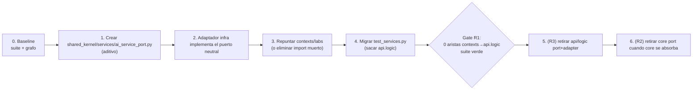

# R1_DEPENDENCY_INVERSION_AUDIT

> **Misión:** `R1_DEPENDENCY_INVERSION_AUDIT`
> **Tipo:** Diseño exclusivo de la corrección de una dependencia · **sin modificar código**.
> **Base:** `docs/SIGCTIARURAL_ARCHITECTURE_RECONCILIATION_AUDIT.md` (Fase R1).
> **Rama:** `feature/cmsc-f3c-v1-implementation` (sin push).
> **Alcance:** **una sola arista** → `contexts/labs` ⟶ `api.logic`.
> **Regla:** NO se modificó código, NO se hicieron commits, NO se hizo push. Este documento es diseño, no ejecución.

---

## 0. Evidencia de la arista (qué es exactamente)

### 0.1 La única importación runtime

| Origen | Línea | Sentencia |
|---|---|---|
| `contexts/labs/domain/services/laboratorio_service.py` | `:9` | `from api.logic.ports.ai_service import AIServicePort` |

Verificado por búsqueda de `from api.logic` sobre todo `src/backend/**/*.py`: **existe una sola coincidencia en `contexts/`** (esta). No hay más aristas `contexts → api.logic`.

### 0.2 Naturaleza de la dependencia: **type hint muerto**

En `contexts/labs/domain/services/laboratorio_service.py`:

- Línea `15`: `def __init__(self, tipo_lab="ROBOTICA", notification_port: NotificationPort = None, ai_service_port: AIServicePort = None):`
- Línea `22`: `self._ai_service_port = ai_service_port`
- **El atributo `_ai_service_port` no se vuelve a usar nunca** dentro del archivo (búsqueda de `_ai_service_port` en `contexts/`: **1 sola coincidencia, la asignación de `:22`**).
- `ejecutar_analisis()` (`:28-41`) solo usa `self._notification_port`; **jamás** `_ai_service_port`.

**Conclusión:** el único uso del contrato importado es **anotar un parámetro opcional que nunca se invoca**. No hay comportamiento que dependa de `api.logic` en runtime; el import sí se ejecuta (Python evalúa la anotación al definir el `def`), por lo que si `api.logic` desaparece, **el módulo deja de importar** (rompería el arranque del contexto), aunque nada de su lógica lo use.

### 0.3 Contratos duplicados en juego

| Definición | Métodos | Evidencia |
|---|---|---|
| `core/ports/services/ai_service_port.py` | `predecir_enfermedad(bytes)->Dict`, `obtener_sugerencias_productividad(Dict)->Dict` | `:6-17` |
| `api/logic/ports/ai_service.py` | **idénticos** | `:4-14` |

Las dos clases son **estructuralmente idénticas** pero **tipos Python distintos** (dos ABC distintas). Un adaptador que hereda de una **no** satisface un `isinstance` contra la otra.

### 0.4 Adaptadores y consumidores (mapa real)

| Adaptador | Implementa | Evidencia |
|---|---|---|
| `api/logic/adapters/ai_service.py` → `FastAPI_AIAdapter` | `api.logic.ports.AIServicePort` | `:1,6` |
| `infrastructure/external/ai_service/fastapi_ai_adapter.py` → `FastAPIAIAdapter` | `core.ports.services.AIServicePort` | `:2,9` |

| Consumidor | Qué usa | Evidencia |
|---|---|---|
| `contexts/labs` | **solo el type hint** (no instancia, no uso) | `laboratorio_service.py:9,15,22` |
| `OnSensorReadingHandler` (labs) | `LaboratorioService(AGRICULTURA, notification_port=…)` — **sin** `ai_service_port` | `on_sensor_reading_handler.py:6-9` |
| `api/views.py` V2 | `api/logic` completa (servicio + `FastAPI_AIAdapter`) | `views.py:407,443,450` |
| `api/views.py` V3 | `core` + `infrastructure` (`get_ai_service()`) | `views.py:73,93,181,363` |

**Conclusión clave:** quitar la arista `contexts/labs → api.logic` **no altera ningún comportamiento**, porque el puerto importado nunca se usa.

---

## 1. Qué contrato debe sobrevivir

**Debe sobrevivir exactamente un `AIServicePort`** con esta superficie (idéntica en ambas copias):

```
AIServicePort (ABC)
├── predecir_enfermedad(imagen_bytes: bytes) -> Dict[str, Any]
└── obtener_sugerencias_productividad(datos_sensores: Dict[str, Any]) -> Dict[str, Any]
```

**Qué NO debe sobrevivir:**
- La copia de `api/logic/ports/ai_service.py` → se retira junto con `api/logic` (Fase R3). Es la que hoy causa la inversión.
- La copia de `core/ports/services/ai_service_port.py` → **no sobrevive como ubicación**; se absorbe (Fase R2). Su contrato sí sobrevive, pero en otra casa.

**Matiz honesto, decisivo para R1:** *dentro de `contexts/labs`* el contrato **no se usa**. Por tanto, para R1 hay dos niveles de respuesta:

- **Nivel mínimo (desbloquea R1):** el contrato **no necesita vivir en `labs`**; basta cortar el import muerto. Cero cambio de comportamiento.
- **Nivel objetivo (si `labs` consumirá IA):** el contrato sobrevive **una sola vez**, en una ubicación neutral compartida, y `labs` la importa desde allí.

El diseño recomendado adopta el **nivel objetivo**, porque preserva el "seam" de IA que el código ya insinuaba (`notificar_analisis_ia` en el `NotificationPort` de labs revela intención de flujo IA→alerta).

---

## 2. Dónde debe vivir `AIServicePort`

### 2.1 Opciones evaluadas

| Opción | Ubicación propuesta | A favor | En contra |
|---|---|---|---|
| **A. `shared_kernel`** *(recomendada)* | `shared_kernel/services/ai_service_port.py` | Una sola definición; consumida por >1 contexto/layer (labs, V3-AI-inference, V2 legacy); framework-free; `shared_kernel` ya es "lo genuinamente compartido" | Engorda el shared kernel más allá de `event_bus`; exige disciplina para no convertirlo en cajón |
| **B. `contexts/ai/ports/`** | `contexts/ai/ports/ai_service_port.py` | DDD-puro si IA es un bounded context | `contexts/ai/` **no existe hoy** (el microservicio AI vive en `src/ai_models/`); crearía un contexto de diseño |
| **C. Puerto del consumidor** | `contexts/labs/ports/ai_service.py` | DDD estricto (el puerto pertenece al consumidor) | Duplica si aparece un segundo consumidor; choca con que labs hoy no lo usa |
| **D. `core/ports/services/`** | (actual) | Cero movimiento | `core` está en absorción → solo traslada el problema |

### 2.2 Recomendación

**Opción A — `shared_kernel/`**, con ubicación concreta:

```
shared_kernel/
├── event_bus/            # (existente)
└── services/
    └── ai_service_port.py   # AIServicePort (definición única)
```

**Razones (basadas en evidencia del grafo, no en preferencia):**
1. El contrato es consumido potencialmente por **más de una parte** (labs, y hoy de hecho V3/V2 vía dos copias) → es un contrato **compartido**, no exclusivo de un contexto.
2. Es **puro** (solo `abc` + `typing`), condición para habitar el shared kernel (`wiring.py:11-18` documenta que `shared_kernel` debe permanecer neutral y sin depender de contextos).
3. El shared kernel ya alberga el otro contrato transversal del sistema (`EventBusPort`), por lo que es coherente.
4. Elimina la **duplicación DUP-6** de un solo golpe: una definición en vez de tres.

**Ubicación descartada explícitamente:** `contexts/labs/ports/` (Opción C) **no** se recomienda *hoy* porque labs no usa el contrato; poner ahí una definición sin consumidor real volvería a crear un contrato muerto.

> Nota de governance: si se adopta A, la regla queda escrita: **`shared_kernel` solo alberga contratos framework-free consumidos por ≥2 contextos.** `AIServicePort` cumple; un hipotético `LabsNotificationPort` no (es de labs) y no debe subir.

---

## 3. Cómo migrar sin romper V2/V3

**Principio:** *adición primero, repunte después, retiro al final*. En ningún paso puede romperse la suite ni V2 ni V3.

### Paso 1 — Crear la casa neutral (aditivo, no rompe nada)
- Añadir `shared_kernel/services/ai_service_port.py` con la definición **idéntica** a las existentes.
- No se toca ningún import todavía. La suite sigue verde.
- V2 (usa `api.logic`) intacto. V3 (usa `core`+`infrastructure`) intacto.

### Paso 2 — Repuntar el adaptador nuevo a la casa neutral
- `infrastructure/.../fastapi_ai_adapter.py` pasa a implementar el puerto de `shared_kernel`.
- V3 no cambia de comportamiento: el adaptador sigue ofreciendo los mismos 2 métodos, y `get_ai_service()` sigue devolviendo el mismo objeto.
- V2 sigue con su `api.logic.ports` sin tocar.

### Paso 3 — Cortar la arista invertida (núcleo de R1)
En `contexts/labs/domain/services/laboratorio_service.py`:
- **3a (recomendada):** cambiar el import `api.logic.ports.ai_service` → `shared_kernel.services.ai_service_port`, conservando el parámetro `ai_service_port` (preserva el seam de IA).
- **3b (mínima):** si se decide que labs no consumirá IA ahora, eliminar import + parámetro + asignación. Es una **firma más simple**, pero cambia la firma pública.

  > En ambos casos, `OnSensorReadingHandler:6-9` no pasa `ai_service_port` → **no se rompe**.

- Después del Paso 3, la arista `contexts → api.logic` **desaparece** (verificable por búsqueda).

### Paso 4 — Migrar el test que ancla al legacy
- `tests/contexts/labs/test_services.py:483` importa `FastAPI_AIAdapter` de `api.logic` y afirma `isinstance(...)`.
- Actualizar para apuntar al adaptador superviviente (`infrastructure` `FastAPIAIAdapter`) **o** retirar la aserción de adaptador legacy si se adopta 3b.
- *(Esta es la única prueba que enlaza labs con el tipo legacy.)*

### Paso 5 — Retiro del legacy (pertenece a R3, no a R1)
- Cuando V2 se retire, se elimina `api.logic/ports/ai_service.py` + `api/logic/adapters/ai_service.py`.
- También se elimina `core/ports/services/ai_service_port.py` cuando `core` se absorba (R2) y su adaptador ya apunte a `shared_kernel`.

### Garantías por consumidor

| Consumidor | ¿Se rompe con R1? | Motivo |
|---|---|---|
| V2 (`TelemetryHistoryV2View`, `AICropAdviceView`) | **No** | usa `api.logic`; R1 no toca `api.logic` |
| V3 (`TelemetryHistoryV3View`, `AIInferenceV3View`) | **No** | usa `core`+`infrastructure`; R1 no toca esos imports |
| Bus (`OnSensorReadingHandler`) | **No** | no pasa `ai_service_port` |
| `tests/contexts/labs/test_services.py` | **Sí, requiere 1 edición** | aserción `isinstance` contra clase legacy (Paso 4) |
| `tests/domain/*` (legacy) | **No en R1** | prueban `api.logic`, que R1 no modifica |

---

## 4. Riesgos

| # | Riesgo | Severidad | Mitigación |
|---|---|---|---|
| R1-a | **Cambio de firma pública** de `LaboratorioService` si se adopta 3b (eliminar `ai_service_port`) | 🟠 Media | Preferir 3a (conservar parámetro re-tipado); si 3b, actualizar los tests que lo pasan |
| R1-b | **Test acoplado al tipo legacy** (`test_services.py:483`) falla si el legacy se retira antes de migrar el test | 🟠 Media | Secuencia obligatoria: Paso 4 antes de cualquier retiro (Paso 5) |
| R1-c | **Dos ABC idénticas y no relacionadas**: un `isinstance` puede fallar silenciosamente entre puertos homónimos | 🟠 Media | Una sola casa (`shared_kernel`); no mantener dos definiciones |
| R1-d | **Engordar el shared kernel** hasta convertirlo en cajón desordenado | 🟡 Baja | Regla de governance: ≥2 consumidores + framework-free (ver §2.2) |
| R1-e | **Pérdida del seam de IA** en labs si se elimina el parámetro (3b) | 🟡 Baja | Elegir 3a si se planea IA en labs |
| R1-f | **Import cycle** si `shared_kernel` alguna vez importa un contexto | 🟠 Media | `shared_kernel` permanece neutral; solo importa stdlib/abc/typing |
| R1-g | **Falso positivo de "ya corregido"**: eliminar el import de texto pero dejar `core` con el mismo patrón como nueva deuda | 🟠 Media | Gate de cierre: verificar que **ninguna** arista `contexts → (api.logic|core)` exista, ni la inversa `core → contexts` |
| R1-h | **Ambiente no verificable end-to-end** (Docker caído): no puede confirmarse el runtime real | 🟠 Media | Ejecutar suite Django en local; el runtime de contenedores queda como verificación pendiente |

---

## 5. Pruebas (diseño de verificación)

### 5.1 Gate de baseline (antes de tocar nada)
- Ejecutar la suite completa y **registrar el conteo** (ancla de no-regresión).
- Ejecutar la búsqueda `from api.logic` en `contexts/` y registrar la arista (debe haber exactamente 1).

### 5.2 Pruebas de la corrección

| Prueba | Qué verifica | Criterio |
|---|---|---|
| **P-1 · Grafo** | No existe arista `contexts → api.logic` | `Select-String -Pattern 'from api.logic'` sobre `contexts/` = **0 coincidencias** |
| **P-2 · Grafo inverso** | No aparece nueva inversión `shared_kernel → context` | `shared_kernel` no contiene `from contexts.` = 0 |
| **P-3 · Firma** | `LaboratorioService` conserva contrato (si 3a) o firma simplificada (si 3b) documentada | test de construcción con/sin `ai_service_port` según la opción elegida |
| **P-4 · Comportamiento labs** | `ejecutar_analisis` sigue igual (estrategia + alerta SOS) | test existente de `LaboratorioService` verde |
| **P-5 · Bus** | `OnSensorReadingHandler` sigue suscrito y publicando | `tests/contexts/labs/test_on_sensor_reading_handler.py` y `tests/sigct_backend/test_wiring.py` verdes |
| **P-6 · Adaptador superviviente** | `FastAPIAIAdapter` implementa el puerto de `shared_kernel` | `isinstance(adapter, AIServicePort_shared)` = True |
| **P-7 · No-regresión V2** | `api/logic` intacto | `tests/api/test_telemetry_history_v2_view.py` verde |
| **P-8 · No-regresión V3** | `core`+`infrastructure`+`contexts` intactos | `tests/api/test_telemetry_ingest_v3_view.py` verde |
| **P-9 · Suite completa** | Nada más se rompió | conteo final ≥ conteo baseline |
| **P-10 · Test migrado** | `test_services.py` ya no importa de `api.logic` | `Select-String 'from api.logic'` sobre `tests/contexts/` = 0 |

### 5.3 Anclas de honestidad
- La prueba **P-1** es la definición operativa de éxito de R1: *la arista invertida ya no existe*.
- La prueba **P-7/P-8** garantiza que "corregir R1" no ha sido en realidad "corregir R2/R3".
- No se aprueba R1 si el conteo de tests baja (salvo que se justifique explícitamente el retiro de un test obsoleto, lo que pertenece a R3).

---

## 6. Roadmap (de la corrección R1)

**Principio:** aditivo → repunte → corte → test → retiro. Cada paso con suite verde.



| Paso | Acción | Rompe algo | Gate |
|---|---|---|---|
| 0 | Baseline: suite + registrar arista | No | conteo registrado |
| 1 | Crear `shared_kernel/services/ai_service_port.py` | No | nueva casa existe, nadie la importa aún |
| 2 | Repuntar adaptador `infrastructure` | No | P-6 verde; V3 igual |
| 3 | Repuntar/cortar `contexts/labs` | No (labs no usa el puerto) | **P-1 = 0**; P-4/P-5 verdes |
| 4 | Migrar `test_services.py` | Solo ese test | P-7, P-8, P-9 verdes |
| 5 | Retirar `api/logic` port+adapter *(pertenece a R3)* | V2 (cuando se retire) | P-7 verde tras reescribir V2 |
| 6 | Retirar `core/ports/.../ai_service_port.py` (R2) | V3 (tras repuntar infra) | P-8 verde |

**Pertenencia de fases:** R1 (esta auditoría) cubre **Pasos 0–4**. Los Pasos 5–6 son de **R2/R3** y se ejecutan en sus propias misiones.

**Autorización:** ningún paso se ejecuta sin orden explícita de Bernardo. Este documento no modifica código.

---

## 7. Veredicto (respuesta directa a las 6 preguntas)

1. **Contrato que debe sobrevivir:** un `AIServicePort` único con `predecir_enfermedad(bytes)->Dict` y `obtener_sugerencias_productividad(Dict)->Dict`. No sobreviven la copia de `api.logic` (causa de la inversión) ni la ubicación de `core`.
2. **Dónde vive:** **`shared_kernel/services/ai_service_port.py`** (contrato compartido, framework-free, consumido por ≥2 partes). Alternativas descartadas: `contexts/ai/` (no existe), `core/` (en absorción), `labs/ports/` (contrato sin consumidor real hoy).
3. **Migrar sin romper V2/V3:** aditivo primero (crear casa neutral), adaptador infra repunta, **cortar el type-hint muerto** de `labs` (que no altera comportamiento porque el puerto nunca se usa), migrar el único test acoplado, y **retirar el legacy solo en R3**. V2 y V3 no se tocan en R1.
4. **Riesgos:** firma pública (R1-a), test acoplado al tipo legacy (R1-b), ABC duplicadas (R1-c), engordar shared kernel (R1-d), falso positivo de corrección (R1-g), ambiente no verificable (R1-h).
5. **Pruebas:** P-1 (0 aristas `contexts→api.logic`) como éxito operativo, más no-regresión V2/V3 (P-7/P-8), bus (P-5), adaptador (P-6) y suite completa (P-9).
6. **Roadmap:** 6 pasos, de los cuales R1 ejecuta 0–4; 5–6 pertenecen a R2/R3.

**Veredicto final:** la inversión `contexts/labs → api.logic` es una **dependencia de tipo muerta** (nunca usada en lógica) y por tanto la corrección es de **bajo riesgo y comportamiento-neutra**. El contrato debe rehacerse **una sola vez en `shared_kernel`** y el corte de la arista se logra sin tocar V2 ni V3.

Sin modificar código, sin commits, sin push.
