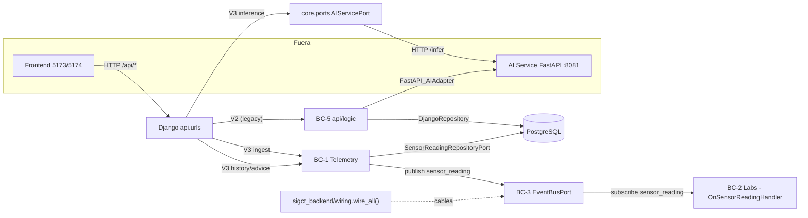
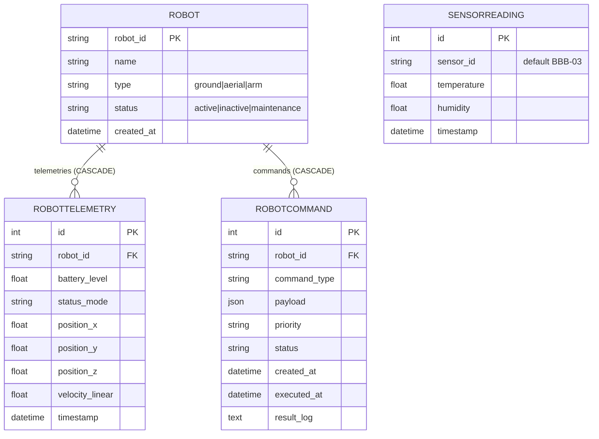
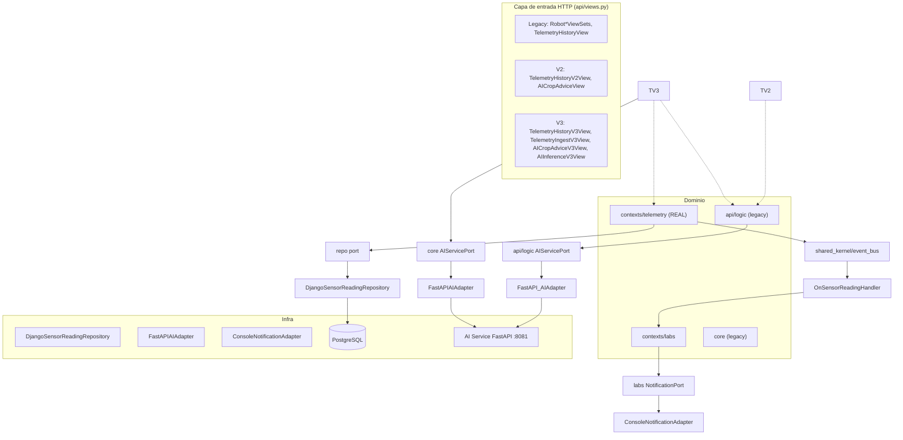
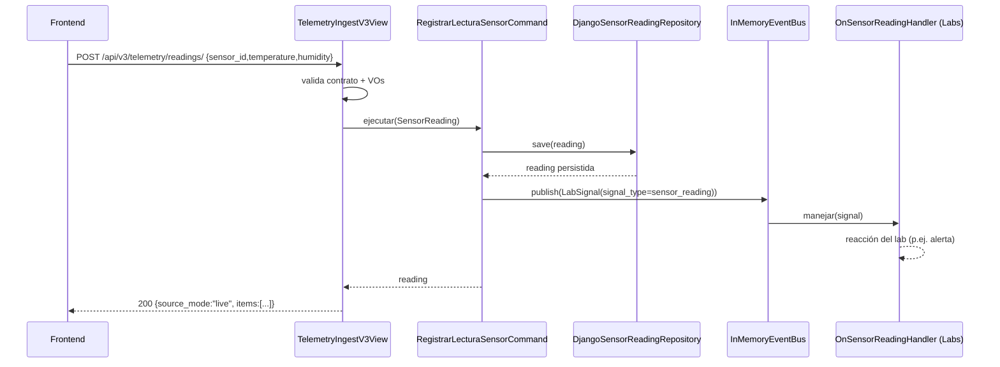

# REAL ARCHITECTURE REPORT — SIGCTIARURAL

> **Misión:** `SIGCTIARURAL_REAL_ARCHITECTURE_AUDIT`
> **Tipo:** Auditoría de solo lectura · derivación de arquitectura REAL desde el código.
> **Rama:** `feature/cmsc-f3c-v1-implementation` (33 commits adelante de origin · sin push).
> **Regla suprema de esta auditoría:** solo se AFIRMA lo que está en el código. Lo demás se marca explícitamente como `SIN EVIDENCIA` o `DISEÑO`. No se modificó código, no se hicieron commits, no se hizo push.
>
> **Fuentes fijadas:** `src/`, `tools/`, `docs/`, `schema_postgresql.sql`, `docker-compose.yml`, `package.json`.
> **Estado del entorno:** daemon Docker NO disponible (`npipe:////./pipe/dockerDesktopLinuxEngine`), por lo que no se validó build/run de contenedores; toda afirmación sobre contenedores proviene de los archivos de definición, no de ejecución.

---

## 0. Método

1. Se recorrió el árbol de `src/backend` completo (dirs + archivos, excluyendo `__pycache__`/`migrations`).
2. Se leyeron los archivos de composición y contrato: `urls.py`, `views.py`, `models.py`, `serializers.py`, `wiring.py`, `dependencies.py`, puertos y adaptadores.
3. Se cruzó el modelo de datos declarado en `models.py` + migraciones contra el dump real `schema_postgresql.sql`.
4. Cada sección responde a uno de los 10 puntos pedidos y cita la ruta (y línea cuando aporta) que lo respalda.

**Convención de estado honesto:** `REAL` (existe y se ejecuta por el arranque), `IMPLEMENTADO-NO-CABLEADO` (código existe pero nada lo invoca en runtime), `DISEÑO`, `SIN EVIDENCIA`.

---

## 1. Bounded Contexts reales

Derivados de la **estructura física de carpetas del backend** (`src/backend/`). No se infieren contextos de la documentación: se listan los que tienen código.

| # | Bounded Context (nombre real en código) | Carpeta raíz | Estado | Evidencia |
|---|---|---|---|---|
| BC-1 | **Telemetry** | `src/backend/contexts/telemetry/` | REAL (endpoints V3 lo usan) | `domain/entities/sensor_reading.py`, `application/commands/registrar_lectura_sensor_command.py`, `ports/sensor_reading_repository.py`, `infrastructure/persistence/{django,in_memory}/`, `infrastructure/config/dependencies.py` |
| BC-2 | **Labs** | `src/backend/contexts/labs/` | IMPLEMENTADO-NO-CABLEADO (solo vía bus) | `domain/strategies/{agricultura,electronica,robotica,telecom,base}.py`, `domain/factories/laboratorio_factory.py`, `domain/services/laboratorio_service.py`, `application/commands/on_sensor_reading_handler.py`, `ports/notifications.py` |
| BC-3 | **Shared Kernel / Event Bus** | `src/backend/shared_kernel/event_bus/` | REAL (en proceso, vía `get_telemetry_event_bus`) | `domain/lab_signal.py`, `ports/event_bus.py`, `infrastructure/in_memory_event_bus.py` |
| BC-4 | **Legacy Core (hexagonal paralela)** | `src/backend/core/` | IMPLEMENTADO-NO-CABLEADO | `domain/entities/sensor_reading.py`, `domain/strategies/*_strategy.py`, `ports/{repositories,services}/` |
| BC-5 | **Legacy API logic** | `src/backend/api/logic/` | IMPLEMENTADO-NO-CABLEADO (solo V2) | `domain/{agricultura,electronica,robotica,telecom,services,factories,interfaces}.py`, `ports/{ai_service,notifications,repositories}.py`, `adapters/{ai_service,notifications,persistence}.py` |
| BC-6 | **Legacy Django App `api`** | `src/backend/api/` | REAL (raíz de URLs) | `models.py`, `views.py`, `serializers.py`, `urls.py` |
| BC-7 | **AI Models (microservicio)** | `src/ai_models/` | REAL (contenedor propio, puerto 8081) | `fastapi_app.py`, `production_models/`, `Dockerfile` |
| BC-8 | **CMSC Data Logger / Bridge** | `tools/cmsc-data-logger/` | REAL (herramienta local) | `bridge/server.js`, `src/ingest.js`, `capture/`, `test/` |
| BC-9 | **Frontend** | `src/frontend/` | REAL (Vite, puerto 5173/5174) | `App.jsx`, `pages/`, `services/`, `stores/` |

**Hallazgo estructural:** existen **dos arquitecturas hexagonales paralelas** conviviendo:

- **Nueva** (contexto real): `contexts/telemetry` + `contexts/labs` + `shared_kernel/event_bus`.
- **Legacy duplicada**: `core/` (entities/strategies/ports) y `api/logic/` (domain/ports/adapters).

Ambas definen un `SensorReading`, value objects de temperatura/humedad/sensor_id, y estrategias de laboratorio. Evidencia de la duplicación: `core/domain/entities/sensor_reading.py` vs `contexts/telemetry/domain/entities/sensor_reading.py`; `core/domain/strategies/{agriculture,electronics,robotics,telecom}_strategy.py` vs `contexts/labs/domain/strategies/{agricultura,electronica,robotica,telecom}.py`; `core/ports/services/ai_service_port.py` vs `api/logic/ports/ai_service.py`.

---

## 2. Context Map

Relación **real** entre contextos verificada en código:

**Patrón de relación dominante:** `Customer/Supplier` con **Published Language** = `LabSignal` (`shared_kernel/event_bus/domain/lab_signal.py`). El acoplamiento Telemetry → Labs es **event-driven y unidireccional** (Telemetry publica `signal_type="sensor_reading"`; Labs escucha). El cableado es explícito en el composition root `sigct_backend/wiring.py:44-72` (decisión documentada en el propio archivo: sin `AppConfig.ready()`).

**Gaps de Context Map (honestos):**

- El composition root `wire_all()` **no se invoca en el arranque del proceso** (su propio docstring lo declara, `wiring.py:31-33`). Sí se invoca indirectamente al construir el bus de telemetry (`contexts/telemetry/infrastructure/config/dependencies.py:40-42`).
- La ruta **Legacy** (`api/logic` + `core`) no publica ni consume el event bus: opera por llamada directa (`views.py:407-470`).
- El frontend llama a Django (`/api/`) y, en ciertas páginas, directamente a `:8081` (`VITE_AI_API_BASE`), según `docker-compose.yml:92-94`.

---

## 3. Entidades reales

### 3.1 Entidades de persistencia (Django ORM) — `src/backend/api/models.py`

| Entidad | Tabla esperada | PK | Campos | Evidencia |
|---|---|---|---|---|
| `SensorReading` | `api_sensorreading` | `id` (implícito) | `sensor_id` CharField(50) def "BBB-03", `temperature` Float, `humidity` Float, `timestamp` DateTime def now | `models.py:4-14` |
| `Robot` | `api_robot` | `robot_id` CharField(50) unique | `name` Char(100), `type` enum(ground/aerial/arm), `status` enum(active/inactive/maintenance), `created_at` | `models.py:20-39` |
| `RobotTelemetry` | `api_robottelemetry` | `id` | FK→`Robot`, `battery_level` Float, `status_mode` Char, `position_{x,y,z}` Float, `velocity_linear` Float, `timestamp` | `models.py:41-53` |
| `RobotCommand` | `api_robotcommand` | `id` | FK→`Robot`, `command_type` Char(50), `payload` JSON, `priority` enum, `status` enum, `created_at`, `executed_at`, `result_log` | `models.py:55-83` |

### 3.2 Entidades de dominio (hexagonal)

| Entidad | Contexto | Definición | Evidencia |
|---|---|---|---|
| `SensorReading` (dataclass) | Telemetry (nueva) | `sensor_id: SensorId, temperature: Temperature, humidity: Humidity, timestamp, id`; invariante: timestamp no futuro | `contexts/telemetry/domain/entities/sensor_reading.py:8-28` |
| `SensorReading` (dataclass) | Core (legacy) | duplicado del anterior | `core/domain/entities/sensor_reading.py` |
| `Laboratorio` (estrategias) | Labs | estrategias por dominio: agricultura/electronica/robotica/telecom | `contexts/labs/domain/strategies/` |
| `Laboratorio` (legacy) | api/logic | servicios/factories por dominio | `api/logic/domain/` |

### 3.3 Value Objects

| VO | Detalle | Evidencia |
|---|---|---|
| `Temperature` | VO inmutable; validada | `contexts/telemetry/domain/value_objects/temperature.py` (y duplicado en `core/`) |
| `Humidity` | VO inmutable; validada | `contexts/telemetry/domain/value_objects/humidity.py` (y duplicado en `core/`) |
| `SensorId` | VO identificador | `contexts/telemetry/domain/value_objects/sensor_id.py` (y duplicado en `core/`) |
| `LabSignal` | VO frozen de transporte inter-contexto (`source_context`, `signal_type`, `timestamp`, `payload`, `signal_id`, `metadata`); payload/metadata inmutables vía `MappingProxyType` | `shared_kernel/event_bus/domain/lab_signal.py:9-34` |

---

## 4. ERD (modelo físico real)

Derivado de `models.py` + migraciones. **Cruce decisivo contra el dump `schema_postgresql.sql`:**

El dump **real** contiene únicamente:
- `public.api_sensorreading`
- tablas built-in de Django: `auth_group`, `auth_group_permissions`, `auth_permission`, `auth_user`, `auth_user_groups`, `auth_user_user_permissions`, `django_admin_log`, `django_content_type`, `django_migrations`, `django_session`.

**Las tablas `api_robot`, `api_robottelemetry`, `api_robotcommand` NO están en el dump**, pese a que la migración `0002_robot_robotcommand_robottelemetry.py` existe y los modelos están declarados. Esto es `SIN EVIDENCIA` de aplicación de la migración 0002 sobre la base volcada → **desfase de esquema real** (ver §10).

> **Nota de honestidad:** `SENSORREADING` no tiene FK a ninguna otra tabla: es una entidad aislada. Las entidades `ROBOT*` existen en código/migración pero **NO en el dump pg publicado** (`schema_postgresql.sql`).

---

## 4-bis. EER (modelo conceptual extendido)

Relaciones y agregados derivados del código:

- **Agregado Robot** (raíz `Robot`): `RobotTelemetry` y `RobotCommand` son partes dependientes (FK CASCADE, related_name `telemetries`/`commands`). Sin `Robot` no existen.
- **Agregado Telemetry**: `SensorReading` es raíz aislada, sin relaciones. Persistida vía `DjangoSensorReadingRepository` (nueva) o `DjangoRepository` (legacy).
- **Sin relación declarada** entre `SensorReading` y `Robot*`: son mundos de datos separados que solo comparten la app Django `api`.

---

## 5. Relaciones (cardinalidades reales)

| Origen | Destino | Cardinalidad | Clave | Evidencia |
|---|---|---|---|---|
| `Robot` | `RobotTelemetry` | 1 → N | FK `robot_id`, `on_delete=CASCADE`, related_name `telemetries` | `models.py:42` |
| `Robot` | `RobotCommand` | 1 → N | FK `robot_id`, `on_delete=CASCADE`, related_name `commands` | `models.py:70` |
| `SensorReading` | — | aislada (1) | sin FK | `models.py:4-14` |

Cardinalidades de integración (no de BD):

| Origen | Destino | Canal | Evidencia |
|---|---|---|---|
| Telemetry | Labs | 1 → N (fan-out pub/sub) | `wiring.py:70` suscribe `OnSensorReadingHandler` a `"sensor_reading"` |
| Django V3 | Telemetry | 1 → 1 (command) | `views.py:253-257` `RegistrarLecturaSensorCommand` |
| Django V3 | AI Service | 1 → 1 (HTTP) | `fastapi_ai_adapter.py:36` `POST {base}/infer` |

---

## 6. Puertos (Ports) reales

| Puerto | Interface | Contexto | Métodos | Evidencia |
|---|---|---|---|---|
| `SensorReadingRepositoryPort` | ABC | Telemetry (nueva) | `save`, `get_all(limit)`, `get_id` | `contexts/telemetry/ports/sensor_reading_repository.py:4-14` |
| `SensorReadingRepositoryPort` | ABC | Core (legacy) | (duplicado) | `core/ports/repositories/sensor_reading_repository.py` |
| `EventBusPort` | ABC | Shared Kernel | `subscribe`, `publish` | `shared_kernel/event_bus/ports/event_bus.py` |
| `AIServicePort` | ABC | Core (nueva ruta V3) | `predecir_enfermedad`, `obtener_sugerencias_productividad` | `core/ports/services/ai_service_port.py` |
| `NotificationPort` | ABC | Core | notificación | `core/ports/services/notification_port.py` |
| `NotificationPort` | ABC | Labs | notificación (duplicado) | `contexts/labs/ports/notifications.py` |
| `AIServicePort` (legacy) | ABC | api/logic | `predecir_enfermedad`, `obtener_sugerencias_productividad` | `api/logic/ports/ai_service.py:4-14` |
| `NotificationPort` (legacy) | ABC | api/logic | — | `api/logic/ports/notifications.py` |
| `RepositoryInterface` (legacy) | ABC | api/logic | `listar_todos`, `obtener`, `…` | `api/logic/ports/repositories.py:4-16` |

**Hallazgo:** el mismo puerto (`AIServicePort`) está definido **dos veces** en módulos distintos (`core.ports.services` y `api.logic.ports`), y `NotificationPort` tiene variantes en `core`, `api/logic` y `contexts/labs`. Los adaptadores nuevos implementan los de `core`; los legacy implementan los de `api/logic`.

---

## 7. Adapters (Adaptadores) reales

| Adaptador | Implementa | Tipo | Evidencia | ¿Cableado en runtime? |
|---|---|---|---|---|
| `DjangoSensorReadingRepository` (nueva) | `contexts.telemetry...SensorReadingRepositoryPort` | Persistencia salida | `contexts/telemetry/infrastructure/persistence/django/django_sensor_reading_repository.py` | SÍ (vía `get_sensor_reading_repository`) |
| `InMemorySensorReadingRepository` (nueva) | idem | Persistencia salida | `contexts/telemetry/infrastructure/persistence/in_memory/…` | SÍ (si `settings.TESTING`) |
| `DjangoSensorReadingRepository` (legacy) | `core.ports...SensorReadingRepositoryPort` | Persistencia salida | `infrastructure/persistence/django/repositories/django_sensor_reading_repository.py` | Parcial (depende de `infrastructure.config.dependencies`) |
| `InMemorySensorReadingRepository` (legacy) | idem | Persistencia salida | `infrastructure/persistence/in_memory/…` | idem |
| `SensorReadingMapper` | — | Mapper | `contexts/telemetry/infrastructure/persistence/django/sensor_reading_mapper.py` | SÍ |
| `LegacySensorReadingRepositoryAdapter` | — | Compat (envuelve ORM) | `contexts/telemetry/infrastructure/compat/legacy_sensor_reading_adapter.py` | SÍ (V2 view) |
| `InMemoryEventBus` | `EventBusPort` | Mensajería salida | `shared_kernel/event_bus/infrastructure/in_memory_event_bus.py` | SÍ (lru_cache por proceso) |
| `FastAPIAIAdapter` (nueva) | `core.ports.services.AIServicePort` | Salida HTTP | `infrastructure/external/ai_service/fastapi_ai_adapter.py` | SÍ (`get_ai_service()`) |
| `FastAPI_AIAdapter` (legacy) | `api.logic.ports.AIServicePort` | Salida HTTP | `api/logic/adapters/ai_service.py` | SÍ (V2 view) |
| `ConsoleNotificationAdapter` (nueva) | `core.ports.services.NotificationPort` | Salida notif. | `infrastructure/external/notifications/console_notification_adapter.py` | SÍ |
| `ConsoleNotificationAdapter` (labs/legacy) | `contexts.labs.ports.NotificationPort` | Salida notif. | `contexts/labs/infrastructure/notifications/console_notification_adapter.py` | SÍ (LabService V3) |
| `DjangoRepository` (legacy) | `RepositoryInterface` | Persistencia salida | `api/logic/adapters/persistence.py` | SÍ (V2 view) |
| `SemanticPredictionResolver` | — | Resolver de salida IA | `infrastructure/external/ai_service/semantic_prediction_resolver.py` | SÍ (V3 inference) |
| `TV3 views` (`TelemetryIngestV3View`, etc.) | — | Adaptadores HTTP de entrada | `api/views.py:102-470` | SÍ |

**Composition roots reales (dos):**
1. `src/backend/sigct_backend/wiring.py` — cablea el bus (`wire_all`).
2. `src/backend/infrastructure/config/dependencies.py` — factorías `get_sensor_reading_repository/get_ai_service/get_notification_service`.
3. `src/backend/contexts/telemetry/infrastructure/config/dependencies.py` — factorías del contexto nuevo + bus.

---

## 8. Diagrama de arquitectura con evidencia (componentes)

---

## 8. APIs HTTP reales (adaptadores de entrada)

`src/backend/sigct_backend/urls.py`: `admin/` + `api/` → `api.urls`.

`src/backend/api/urls.py`:

| Método/Ruta | Vista | Clase | Estado |
|---|---|---|---|
| `/api/robots/` | `RobotViewSet` | ModelViewSet | REAL (AllowAny) |
| `/api/robot-telemetry/` | `RobotTelemetryViewSet` | ModelViewSet | REAL (AllowAny) |
| `/api/robot-commands/` | `RobotCommandViewSet` | ModelViewSet | REAL (IsAuthenticated) |
| `/api/auth/login/` | `TokenObtainPairView` | — | REAL (JWT) |
| `/api/auth/refresh/` | `TokenRefreshView` | — | REAL (JWT) |
| `/api/telemetry/history/` | `TelemetryHistoryView` | APIView | REAL (mock si vacío, `views.py:50-66`) |
| `/api/v2/telemetry/history/` | `TelemetryHistoryV2View` | APIView | REAL (legacy hex) |
| `/api/v2/ai/crop-advice/` | `AICropAdviceView` | APIView | REAL (legacy hex) |
| `/api/v3/telemetry/history/` | `TelemetryHistoryV3View` | APIView | REAL (hex nueva; simula si vacío) |
| `/api/v3/ai/crop-advice/` | `AICropAdviceV3View` | APIView | REAL |
| `/api/v3/telemetry/readings/` | `TelemetryIngestV3View` | APIView | REAL (ingesta, contra `RegistrarLecturaSensorCommand`) |
| `/api/v3/ai/inference/` | `AIInferenceV3View` | APIView | REAL (imagen → `predict`) |

> Las rutas V3 se registran dentro de `try/except ImportError` (`urls.py:30-46`): si sus dependencias faltan, **desaparecen silenciosamente**.

---

## 9. Diagramas CON evidencia

1. **Context Map** (§2) — respaldado por `views.py`, `wiring.py`, `dependencies.py`.
2. **ERD** (§4) — respaldado por `models.py` + `schema_postgresql.sql`.
3. **Diagrama de contenedores/servicios** — respaldado por `docker-compose.yml`: `db` (postgres:15, host-port `${POSTGRES_PORT:-5544}:5432`), `db-mysql` (mysql:8.0, residuo declarado, `3316:3306`), `backend` (build `./src/backend`, `${BACKEND_PORT:-8010}:8000`), `ai_service` (build `./src/ai_models`, `${AI_PORT:-8081}:8081`), `frontend` (build context raíz, `src/frontend/Dockerfile`, `${FRONTEND_PORT:-5173}:80`).
4. **Diagrama de componentes backend** (§8) — respaldado por el árbol de carpetas real y las clases de puertos/adaptadores.
5. **Diagrama de flujo de ingesta** — respaldado por `views.py:201-327` (`TelemetryIngestV3View` → command → repo → bus → handler).

---

## 10. Diagramas / afirmaciones SIN evidencia (gaps declarados)

Estos puntos **NO** están respaldados por el código tal como está hoy. Se declaran para honestidad (regla suprema del proyecto).

| # | Gap | Detalle | Evidencia de la ausencia |
|---|---|---|---|
| G1 | **Desfase de esquema** | `schema_postgresql.sql` solo tiene `api_sensorreading` + tablas Django; **faltan** `api_robot`, `api_robottelemetry`, `api_robotcommand` pese a existir migración `0002_robot_robotcommand_robottelemetry.py` y modelos | `SELECT` sobre nombres de tabla en `schema_postgresql.sql` vs `models.py:20-83` y migración `0002` |
| G2 | **Doble arquitectura hexagonal** | `core/` y `api/logic/` duplican entidades, VOs, puertos y estrategias de `contexts/` | Comparación de árbol `core/`, `api/logic/`, `contexts/` |
| G3 | **Composition root no invocado en arranque** | `wire_all` no se llama desde AppConfig/ready/wsgi; solo desde `get_telemetry_event_bus()` | `wiring.py:63` (docstring) + `contexts/telemetry/.../dependencies.py:40-42` |
| G4 | **Endpoints V3 condicionales** | V3/Inference se registran en `try/except ImportError` → pueden no existir sin error visible | `urls.py:30-46` |
| G5 | **Datos simulados en respuesta REAL** | `TelemetryHistoryView` devuelve mock si no hay filas (`sensor:"Simulado"`); `TelemetryHistoryV3View` marca `source_mode:"simulated"` | `views.py:50-66`, `views.py:137-174` |
| G6 | **`db-mysql` residuo** | Servicio MySQL declarado en compose sin uso por Django (sin driver/referencias) | `docker-compose.yml:24-42` (comentario) |
| G7 | **IA como caja negra** | Backend solo conoce contrato HTTP `/infer` y `/suggest`; no valida el modelo interno | `fastapi_ai_adapter.py:36,46` |
| G8 | **Puertos duplicados** | `AIServicePort` y `NotificationPort` definidos en varios módulos incompatibles entre sí | `core/ports/services/`, `api/logic/ports/`, `contexts/labs/ports/` |
| G9 | **Bridge acústico local-only** | `tools/cmsc-data-logger/bridge` no aparece en `docker-compose.yml` | ausencia en `docker-compose.yml` |
| G10 | **S81/S82, ACP, Telemetría V3 conceptual** | Documentación de diseño; el código actual solo cubre SensorReading/Robot y el microservicio de fitopatología | `api/models.py`, `ai_models/` |
| G11 | **Ejecución de contenedores** | No se pudo verificar build/run por daemon Docker caído | error `npipe:////./pipe/dockerDesktopLinuxEngine` |

---

## 11. Síntesis

- **Contextos reales:** Telemetry (REAL), Labs (vía bus), Shared Kernel EventBus, microservicio AI, Bridge/Logger, Frontend. Más una **doble arquitectura hexagonal legacy** (`core/` + `api/logic/`) coexistiendo.
- **Modelo de datos real:** 4 entidades Django (SensorReading + 3 de robótica), pero el dump pg publicado **solo materializa SensorReading** (G1).
- **Integración real entre contextos:** pub/sub en proceso con `LabSignal` + `InMemoryEventBus` + `wiring.wire_all` (no disparado en arranque, G3).
- **Puertos/adaptadores:** patrón hexagonal correcto, pero **duplicado** (G2, G8).
- **Honestidad:** varios endpoints caen a datos simulados sin distinguirlos en la superficie legacy (G5), y la IA real es HTTP a un servicio aparte (G7).

> **Veredicto de la auditoría:** la arquitectura REAL es un **hexagonal en transición**: el contexto Telemetry + EventBus es la parte nueva y operativa; `core/`/`api/logic/` son el remanente no retirado; el microservicio AI está desacoplado por HTTP; y el modelo de datos publicado está **desincronizado** con el modelo declarado (§4, G1). No se modificó nada.
