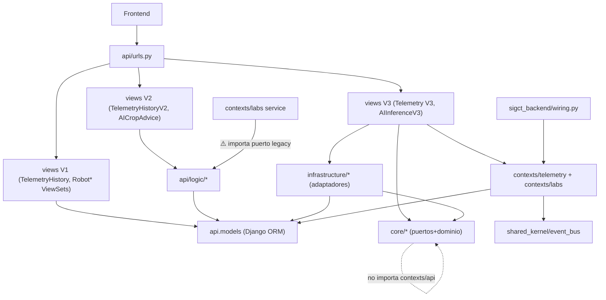
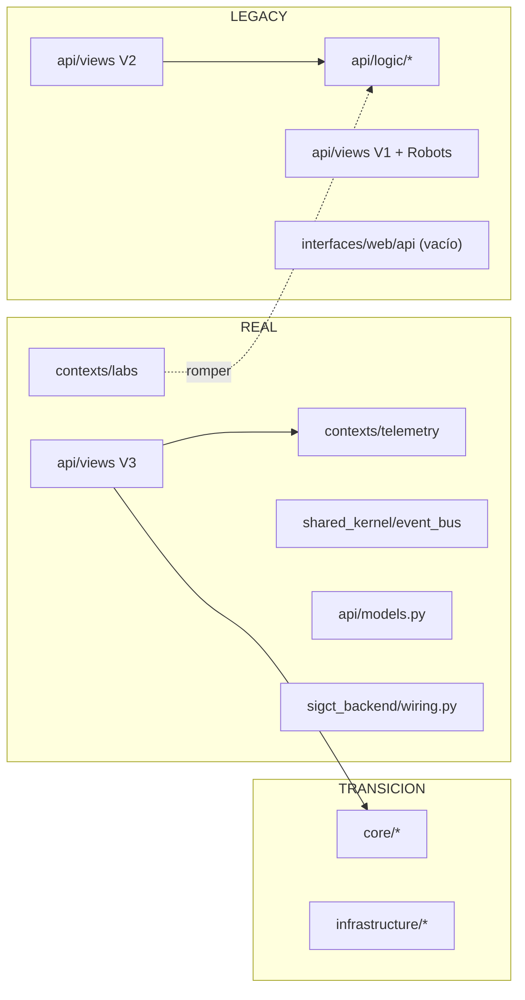

# SIGCTIARURAL_ARCHITECTURE_RECONCILIATION_AUDIT

> **Misión:** `SIGCTIARURAL_ARCHITECTURE_RECONCILIATION_AUDIT`
> **Tipo:** Auditoría de reconciliación arquitectónica · solo lectura.
> **Base:** `docs/REAL_ARCHITECTURE_REPORT.md` + `docs/G1_SCHEMA_CONSISTENCY_REPORT.md`.
> **Rama:** `feature/cmsc-f3c-v1-implementation` (sin push).
> **Regla suprema:** solo se AFIRMA lo que está en el código. NO se modificó código, NO se hicieron commits, NO se hizo push.
>
> **Pregunta central:** ¿qué arquitectura debe sobrevivir entre `contexts/*`, `core/*` y `api/logic/*`, y qué es REAL, TRANSICIÓN o LEGACY?

---

## 0. Método

1. Se leyó el contenido de cada estructura competidora y sus servicios/estrategias homólogos.
2. Se levantó el **grafo real de dependencias** (qué importa a quién) con `Select-String` sobre `*.py` (excluyendo `__pycache__`).
3. Se cruzó con la cobertura de tests (`tests/`) y con el cableado real de las vistas (`api/views.py`, `api/urls.py`).
4. Se cuantificó tamaño e integración por estructura.
5. Se declara estado honesto por componente: **REAL**, **TRANSICIÓN**, **LEGACY**.

---

## 0-bis. Grafo real de dependencias (la evidencia decisiva)



**Importaciones verificadas (hechos):**

| Origen | Importa | Evidencia |
|---|---|---|
| `contexts/labs/domain/services/laboratorio_service.py` | **`api.logic.ports.ai_service`** ⚠️ | `:9` |
| `contexts/telemetry/.../django_sensor_reading_repository.py` | `api.models` | `:3` |
| `contexts/telemetry/.../sensor_reading_mapper.py` | `api.models` | `:3` |
| `contexts/telemetry/.../config/dependencies.py` | `shared_kernel.event_bus` | `:5` |
| `core/*` | **nada de `contexts`/`api`** (autocontenido) | sin coincidencias |
| `infrastructure/*` | `core.*` + `api.models` | `dependencies.py:2-3`, repos/mappers |
| `api/logic/*` | **nada de `contexts`/`core`/`infrastructure`** (autocontenido) | sin coincidencias |
| `api/views.py` V3 | `core.*` + `infrastructure.*` + `contexts.*` | `:72-84`, `:410` |
| `interfaces/web/api/*` | — (carpetas **vacías**, 0 bytes) | árbol |

**Lectura clave:** la vista V3 **mezcla** `core/` (para `LabService`, `get_ai_service`, `get_sensor_reading_repository`) y `contexts/` (para ingesta y bus). `contexts/labs` **depende del puerto legacy `api/logic`**. `core/` está limpio y autocontenido. `api/logic/` está limpio pero es el más antiguo.

---

## 1. Arquitectura objetivo

**Decisión propuesta: la arquitectura objetivo es la de `contexts/*` + `shared_kernel/*` (DDD / hexagonal por bounded contexts), con `core/*` solo como origen temporal de puertos/adaptadores y `api/logic/*` retirado.**

Justificación basada en evidencia (no en diseño):

| Criterio | `contexts/*` | `core/*` | `api/logic/*` |
|---|---|---|---|
| Patrón explícito DDD (`domain/application/infrastructure/ports`) | ✅ completo | ⚠️ parcial (sin `infrastructure`) | ✅ parcial |
| Integración con Event Bus (`shared_kernel`) | ✅ sí | ❌ no | ❌ no |
| Endpoints que lo usan | V3 (nuevo) | V3 (history) | **V2 (legacy)** |
| Cobertura de tests propia | ✅ `tests/contexts/*` | ✅ `tests/domain/*` | ⚠️ tests legacy (`tests/domain/test_services`, `test_factories`) |
| Bounded contexts definidos | ✅ `telemetry`, `labs` | ❌ (capa, no contexto) | ❌ (capa) |
| Nombre en inglés/español consistente | español | **inglés** | español |
| Fecha/procedencia | Más reciente (V3, bus, Day 16-17) | Intermedia | Primer intento (mayo 2026) |

**Motor de la decisión:** `contexts/` es la única estructura con (a) separación por bounded context, (b) integración con el `EventBusPort`, (c) endpoints `/v3/` montados, y (c) tests propios coherentes. Es la dirección en curso del proyecto.

**Matiz honesto (sin el cual la decisión sería incompleta):** `contexts/*` **hoy no es autosuficiente**:

- `contexts/labs` importa el puerto **legacy** `api.logic.ports.ai_service` (`laboratorio_service.py:9`).
- `contexts/telemetry` importa **directamente el ORM** `api.models` (`django_sensor_reading_repository.py:3`, `sensor_reading_mapper.py:3`) — acoplamiento de infraestructura aceptable, pero está **duplicando** lo que `core`+`infrastructure` ya hacen.

Por tanto la arquitectura objetivo **no existe todavía**; existe su **núcleo** (`contexts` + `shared_kernel`) rodeado de dos capas incompatibles. Reconciliar = converger hacia `contexts`.

**Forma objetivo (destino):**

```
src/backend/
├── shared_kernel/            # lo genuinamente compartido (event_bus, contratos base)  [REAL]
├── contexts/
│   ├── telemetry/            # BC Telemetría: domain + application + ports + infra      [REAL]
│   └── labs/                 # BC Labs: domain(estrategias) + application(handlers)     [REAL]
├── infrastructure/           # adaptadores de salida compartidos (AI, notifications, ORM) [TRANSICIÓN]
├── api/                      # Django: models (persistencia) + urls + views (adaptadores de entrada) [REAL]
└── (core/, api/logic/)       # ABSORBIDOS y desaparecidos
```

---

## 2. Contextos canónicos

| Contexto | Carpeta | Estado | Rol canónico | Evidencia |
|---|---|---|---|---|
| **Telemetry** | `contexts/telemetry/` | **REAL** | Lecturas de sensores; publica `sensor_reading` | `domain/entities/sensor_reading.py`, `application/commands/registrar_lectura_sensor_command.py`, `ports/`, `infrastructure/` |
| **Labs** | `contexts/labs/` | **REAL** | Consumidor de señales; estrategias por dominio (agro/electrónica/robótica/telecom) | `domain/strategies/`, `application/commands/on_sensor_reading_handler.py` |
| **Shared Kernel (EventBus)** | `shared_kernel/event_bus/` | **REAL** | Transporte inter-contexto (`LabSignal`, `EventBusPort`, `InMemoryEventBus`) | `domain/lab_signal.py`, `ports/event_bus.py`, `infrastructure/in_memory_event_bus.py` |
| Composition root | `sigct_backend/wiring.py` | **REAL (no autoinvocado)** | Cablea suscriptores; único lugar de acoplamiento pub/sub | `wiring.py:44-72` |

**Contextos candidatos NO canónicos (reservados / fuera de alcance):**

- **AI**: hoy es un **microservicio** (`src/ai_models/fastapi_app.py`), no un `contexts/ai/`. `docs/SIGCTIARURAL_COMPONENT_MAP.md:98` lo llama "contexts/ai operativo", pero **esa carpeta no existe**. El consumo backend es vía puerto `AIServicePort` + adaptador `FastAPIAIAdapter`.
- **BiologicalTelemetry / UBTN**: **DISEÑO** (solo `docs/MASTERDOC.md:324`), sin código.
- **Robótica**: hoy **no** es contexto; vive como ViewSets legacy sobre `api.models` (ver §3).

---

## 3. Componentes legacy

| Componente | Clasificación | Motivo | Evidencia |
|---|---|---|---|
| `api/logic/**` (domain/ports/adapters) | **LEGACY** | Autocontenido; solo consumido por V2 y tests; sin bus; sin tests de contexto; reemplazado por `core`→`contexts` | `views.py:407-470`; `tests/conftest.py:6` |
| `api/views.py` V1 (`TelemetryHistoryView`) | **LEGACY** | ORM directo + mock | `views.py:33-66` |
| ViewSets `RobotViewSet` / `RobotTelemetryViewSet` / `RobotCommandViewSet` | **LEGACY** | ORM directo, sin puerto/adaptador; `Robot*` huérfanas (G1) | `views.py:16-31`; `urls.py:13-16` |
| `api/urls.py` rutas `/v2/` | **LEGACY** | Sirven `api/logic` | `urls.py:23-24` |
| `core/**` | **TRANSICIÓN** | Capa intermedia funcional (usada por V3 e `infrastructure`); define puertos/entidades/VOs que **deberían** vivir en `contexts`/`shared_kernel` | `views.py:72`; `infrastructure/*` |
| `infrastructure/**` | **TRANSICIÓN** | Adaptadores de salida (AI HTTP, notif, ORM) que aún usan los puertos de `core`; deben re-apuntar a puertos de contextos | `dependencies.py:2-3` |
| `interfaces/web/api/**` | **LEGACY/ASPIRACIONAL** | Carpetas **vacías** (0 bytes); estructura planeada nunca usada | árbol `interfaces/` |
| `api/views.py` V3 + `AIInferenceV3View` | **REAL (destino)** | Adaptadores de entrada hacia `contexts`/`core` | `views.py:101-402` |
| `api/models.py` | **REAL (compartido)** | Persistencia común a legacy y contextos | G1_REPORT §1.2 |

**Nota:** el término "LEGACY" aquí es **descriptivo** (anterior, en retirada), no un juicio de calidad. `api/logic` y `core` están bien construidos; el problema es la **coexistencia**.

---

## 4. Duplicidades

| # | Concepto duplicado | Copias | Evidencia |
|---|---|---|---|
| DUP-1 | Entidad `SensorReading` de dominio | 2 → `core/domain/entities/sensor_reading.py`, `contexts/telemetry/domain/entities/sensor_reading.py` | árbol |
| DUP-2 | Value Objects (`Temperature`, `Humidity`, `SensorId`) | 2 → `core/domain/value_objects/*`, `contexts/telemetry/domain/value_objects/*` | árbol |
| DUP-3 | Repositorio `DjangoSensorReadingRepository` | 2 → `infrastructure/persistence/django/repositories/...`, `contexts/telemetry/infrastructure/persistence/django/...` | ambas clases verificadas |
| DUP-4 | `SensorReadingMapper` | 2 | `infrastructure/.../mappers/`, `contexts/telemetry/.../django/sensor_reading_mapper.py` |
| DUP-4b | Repositorio in-memory | 2 → `infrastructure/persistence/in_memory/`, `contexts/telemetry/infrastructure/persistence/in_memory/` | árbol |
| DUP-5 | Puerto `SensorReadingRepositoryPort` | 2 → `core/ports/repositories/`, `contexts/telemetry/ports/` | árbol |
| DUP-6 | Puertos de servicios (`AIServicePort`, `NotificationPort`) | 3 → `core/ports/services/`, `api/logic/ports/`, `contexts/labs/ports/` | lecturas |
| DUP-7 | Servicio `LaboratorioService`/`LabService` | **3** → `core/domain/services/lab_service.py`, `contexts/labs/domain/services/laboratorio_service.py`, `api/logic/domain/services.py` | lecturas (casi idénticos) |
| DUP-8 | Estrategias de laboratorio (agro/electrónica/robótica/telecom) | **3 juegos** → `contexts/labs/domain/strategies/`, `core/domain/strategies/`, `api/logic/domain/` | `agriculture_strategy.py` vs `agricultura.py` (lógica idéntica) |
| DUP-9 | Adaptador IA | 2 → `infrastructure/external/ai_service/fastapi_ai_adapter.py` (nuevo), `api/logic/adapters/ai_service.py` (`FastAPI_AIAdapter`) | firmas equivalentes |

**Magnitud:** para un dominio que hoy solo persiste **1 tabla real** (`api_sensorreading`), se mantienen **3 servicios de laboratorio, 3 juegos de estrategias, 2–3 puertos por concepto y 2 adaptadores IA**. La duplicación es el **problema central** de la reconciliación.

---

## 5. Riesgos

| # | Riesgo | Severidad | Fundamento |
|---|---|---|---|
| R-1 | **Divergencia de comportamiento:** las 3 copias de las estrategias/servicios evolucionan por separado (ya divergen en nombres: `AgricultureStrategy` vs `ProcesadorAgricultura`) | 🔴 Alta | DUP-7, DUP-8 |
| R-2 | **Dependencia invertida nueva→legacy:** `contexts/labs` (destino) importa `api.logic` (legacy). Si se retira legacy primero, **rompe el contexto canónico** | 🔴 Alta | `laboratorio_service.py:9` |
| R-3 | **Acoplamiento directo al ORM en `contexts/telemetry`**: el contexto canónico importa `api.models`; mover/renombrar el modelo impacta el contexto | 🟠 Media | `django_sensor_reading_repository.py:3` |
| R-4 | **V3 mezcla dos arquitecturas** (`core` + `contexts`): el destino no es internamente coherente aún | 🟠 Media | `views.py:72-84` |
| R-5 | **Retiro prematuro de legacy** rompe `V2`, `conftest.py` y tests de `tests/domain/test_services.py` | 🟠 Media | `views.py:443`, `tests/conftest.py:6` |
| R-5b | **Retiro de `core` primero** rompe V3 (`LabService`, `get_ai_service`) e `infrastructure` entera | 🔴 Alta | `views.py:72-77`; `infrastructure/*` |
| R-6 | **Estructura fantasma `interfaces/`** induce a creer que existe una capa web hexagonal que no está implementada | 🟡 Baja | carpetas 0 bytes |
| R-5b-bis | **Entidades `Robot*` huérfanas** (G1) sin puerto/adaptador: reconciliarlas exige decidir si se retiran o se modelan como contexto | 🟠 Media | G1_REPORT |
| R-7 | **Tests como ancla de legacy:** `tests/domain/*` (factories/services) prueban `api/logic`, por lo que retirarlo requiere migrar tests | 🟠 Media | `tests/domain/test_factories.py`, `test_services.py` |
| R-8 | **Riesgo de "big bang":** intentar eliminar 2 capas a la vez puede romper V2/V3 y el bus | 🔴 Alta | grafo §0-bis |

---

## 6. Roadmap de reconciliación

**Principio rector:** *converger a `contexts`, absorber `core`, retirar `api/logic` — en pasos reversibles y con tests por paso.* No es un rediseño; es una **convergencia**.

### Fase R0 — Congelar y medir (sin cambios de código)
- Fixar la baseline honesta: `contexts` = REAL, `core`+`infrastructure` = TRANSICIÓN, `api/logic`+V1/V2+Robot* = LEGACY.
- Ejecutar suite completa y registrar el conteo (ancla de no-regresión).
- Documentar el grafo de dependencias (§0-bis) como contrato de la reconciliación.

### Fase R1 — Curar la dependencia invertida (R-2) — **bloqueante de todo**
- Mover el contrato `AIServicePort` que `contexts/labs` importa a un lugar neutral (contexto propio o `shared_kernel`), eliminando `contexts → api.logic`.
- Criterio de salida: **`contexts/*` no importa `api.logic`** (verificable por búsqueda).

### Fase R2 — Absorber `core` en `contexts`/`shared_kernel`
- Decidir cada pieza de `core`:
  - Entidades/VOs `SensorReading` → quedarse en `contexts/telemetry` (DUP-1/DUP-2).
  - Puertos `AIServicePort`/`NotificationPort` → `shared_kernel` o puerto del contexto consumidor (DUP-6).
  - Estrategias/servicio `LabService` → `contexts/labs` (DUP-7/DUP-8).
- Repuntar `infrastructure/*` a los puertos de contexto/shared en vez de `core`.
- Criterio de salida: **0 importaciones de `core.*`** fuera de `core/`.

### Fase R3 — Retirar `api/logic`
- Re-apuntar `TelemetryHistoryV2View`/`AICropAdviceView` a `contexts`/`infrastructure` (o reemplazarlas por V3).
- Migrar `tests/domain/{test_factories,test_services}.py` a `tests/contexts/`.
- Criterio de salida: **cero imports `api.logic`**; `/v2/` servido por contextos o deprecado en `/v3/`.

### Fase R3b — Resolver `Robot*` (depende de G1)
- Con G1 resuelto (migración `0002` aplicada o `Robot*` retiradas), decidir: **contexto Robótica con puertos/adaptadores** o **retiro controlado** de los ViewSets.
- Criterio de salida: o `Robot*` tiene `ports/`+`adapters/`, o desaparece del `api/urls.py`.

### Fase R4 — Limpieza estructural
- Eliminar `interfaces/web/api/` vacío o poblarlo (R-6).
- Eliminar `core/` una vez vacío (R2) y `api/logic/` (R1–R3).
- Criterios de salida: una sola capa de puertos, una sola entidad `SensorReading`, un solo juego de estrategias.

### Fase R5 — Reubicar adaptadores de salida
- Renombrar `infrastructure/` a algo que refleje su rol (adaptadores de salida compartidos) o integrarlo en `contexts/*/infrastructure`.
- Criterio: **una sola fuente de adaptadores IA/notificaciones/ORM**.

**Gate global:** cada fase termina con (a) suite verde, (b) grafo de dependencias sin la arista que se quiso eliminar, (c) `git status` sin cambios no intencionales. Sin autorización explícita de Bernardo, las fases **no se ejecutan** (esta auditoría no toca código).

---

## 6.1 Veredicto de supervivencia (respuesta directa)

| Estructura | Veredicto | Estado |
|---|---|---|
| `contexts/*` | **SOBREVIVE** → arquitectura objetivo | REAL (con 2 acoplamientos a corregir: `api.logic` port y `api.models`) |
| `shared_kernel/event_bus` | **SOBREVIVE** | REAL |
| `core/*` | **SE ABSORBE** (no sobrevive como capa) | TRANSICIÓN (origen de puertos/estrategias) |
| `infrastructure/*` | **SUPERVIVE reubicado** (adaptadores de salida) | TRANSICIÓN |
| `api/logic/*` | **SE RETIRA** | LEGACY |
| `api/views.py` V1/V2 + `Robot*` | **SE RETIRA** | LEGACY |
| `api/views.py` V3 + `api/urls.py` | **SOBREVIVE** → adaptadores de entrada | REAL |
| `api/models.py` | **SOBREVIVE** (persistencia compartida) | REAL |
| `interfaces/web/api/*` | **SE RETIRA** (vacío) | LEGACY/ASPIRACIONAL |

**En una frase:** *converger a `contexts` + `shared_kernel`; absorber `core`; retirar `api/logic`; corregir primero la dependencia invertida `contexts/labs → api/logic`.*

---

## 7. Anexo — Estados por componente (mapa rápido)



Sin modificaciones de código, sin commits, sin push.
