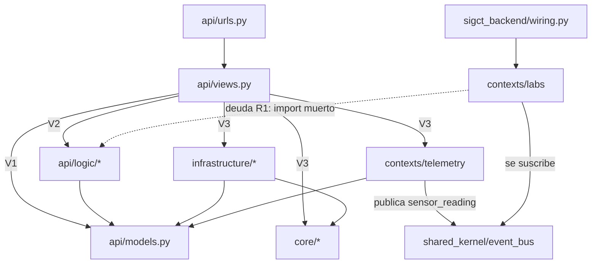

# Arquitectura — SIGCT-Rural (estado verificado)

> **Estado:** vigente (actualizado 2026-10, misión `DOCUMENTATION_FREEZE_EXECUTION`).
> **Fuente de verdad:** `docs/MASTERDOC.md §1` · `docs/REAL_ARCHITECTURE_REPORT.md` · `docs/CANONICAL_DIAGRAM_MANIFEST.md`.
> **Context Map AS-IS:** `docs/eiarc/03_DIAGRAMS/SIGCT_RURAL_CONTEXT_MAP_AS_IS.mmd`.

Este documento describe la arquitectura **real** del backend (no el objetivo aspiracional). Conviven **tres capas históricas** + un **núcleo DDD** en materialización.

## 1. Nivel 1: Vista de Contexto (C4)
Usuarios y sistemas externos. *(Diagrama en el README principal.)*

## 2. Nivel 2: Vista de Contenedores
Frontend (Vite) · Backend (Django :8010), AI Service (FastAPI), PostgreSQL, Edge. *(Ver README principal.)*

## 3. Backend — estado real verificado (2026-10)

**Coexisten** (ver `MASTERDOC §1.1` y `REAL_ARCHITECTURE_REPORT`):

| Capa | Ubicación | Estado | Rol |
|---|---|---|---|
| **V1 legacy** | `api/views.py`, `api/models.py` | Activa | ORM directo |
| **V2 legacy** | `api/logic/{domain,ports,adapters}/` | En deprecación | Strategy+Factory; lo sirven `/api/v2/*` |
| **V3 (transición)** | `core/` + `infrastructure/` | Activa (`/api/v3/*`) | Hexagonal estricta |
| **Contextos DDD (destino)** | `contexts/{telemetry,labs}/` + `shared_kernel/event_bus/` | **Parcial (real en disco)** | Bounded Contexts + Shared Kernel; cableado por eventos |

### Diagrama real (AS-IS)

> Mapa completo y comentado: `docs/eiarc/03_DIAGRAMS/SIGCT_RURAL_CONTEXT_MAP_AS_IS.mmd`.

### 3.1 Estado por capa (honesto)

- **`contexts/telemetry` — REAL.** Dominio, aplicación, puertos e infraestructura; publica `sensor_reading` como `LabSignal` por el bus; persistencia vía `api.models`.
- **`contexts/labs` — REAL (vía bus).** Estrategias por dominio (agricultura, electrónica, robótica, telecom) + `OnSensorReadingHandler`. **`wire_all()` no se invoca al arranque**, por lo que en producción no recibe señales aún.
- **`shared_kernel/event_bus` — REAL.** `EventBusPort` + `InMemoryEventBus` + `LabSignal`; neutral (no depende de contextos).
- **`core/` + `infrastructure/` — TRANSICIÓN.** Definición estricta hexagonal que se **absorbe** en `contexts`/`shared_kernel` (R2, no ejecutado).
- **`api/logic/` — LEGACY en deprecación.** Consumido por V2 y tests.
- **`interfaces/`** — estructura **vacía** (0 bytes).

### 3.2 Deuda registrada (no resuelta)

- **R1 (dependencia invertida):** `contexts/labs/domain/services/laboratorio_service.py:9` importa `api.logic.ports.ai_service.AIServicePort` — **import muerto** (type-hint nunca usado). Ver `docs/R1_DEPENDENCY_INVERSION_AUDIT.md`.
- **`wire_all()` sin arranque:** el caso Telemetría→Labs está cableado pero **no activo** en el boot de Django.

### 3.3 Fuente de verdad

- **Esquema:** `src/backend/api/models.py` + `src/backend/api/migrations/` (`MASTERDOC §2.9`; `docs/database/er_schema_v8.mmd`).
- **Contextos:** `docs/eiarc/02_ARCHITECTURE/EIARC_CONTEXTS.md` (7 contextos oficiales) + `docs/eiarc/03_DIAGRAMS/*_V8.mmd`.
- **Diagramas:** `docs/CANONICAL_DIAGRAM_MANIFEST.md`.

### Ventajas del diseño hexagonal (vigente)

- **Testabilidad:** se prueba la lógica sin levantar Django.
- **Flexibilidad:** cambiar el adaptador de persistencia sin tocar el dominio.
- **Aislamiento:** el servicio de IA es un runtime independiente (FastAPI), accedido por puerto.

---

*Actualizado 2026-10 (misión `DOCUMENTATION_FREEZE_EXECUTION`). Histórico: la versión previa describía solo el hexágono V2.*
*Bernardo Adolfo Gómez Montoya — 2026*
